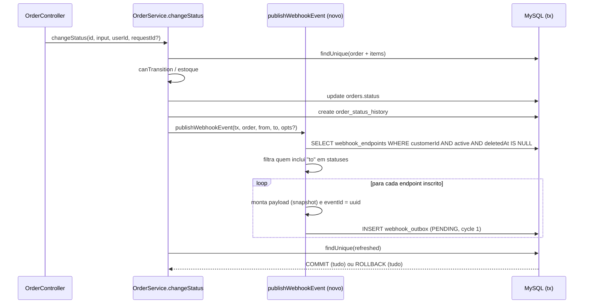
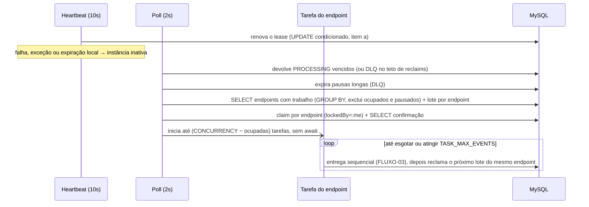
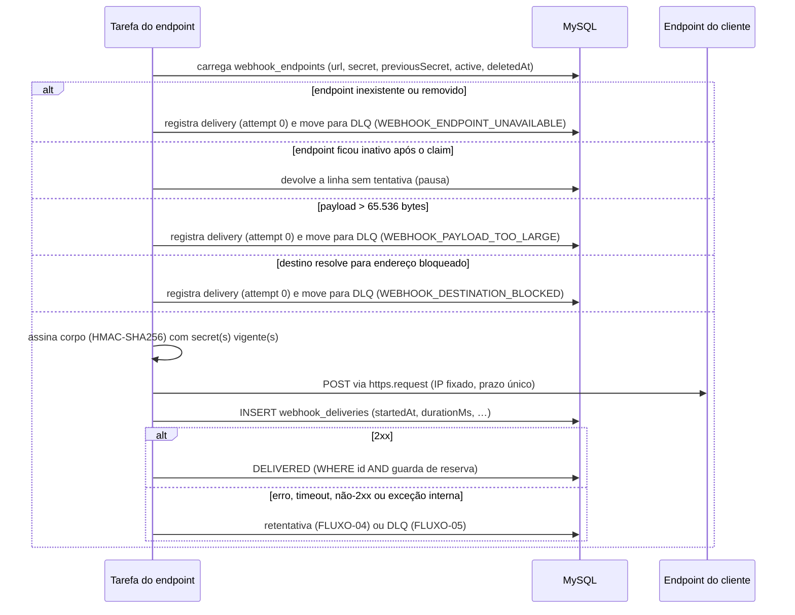
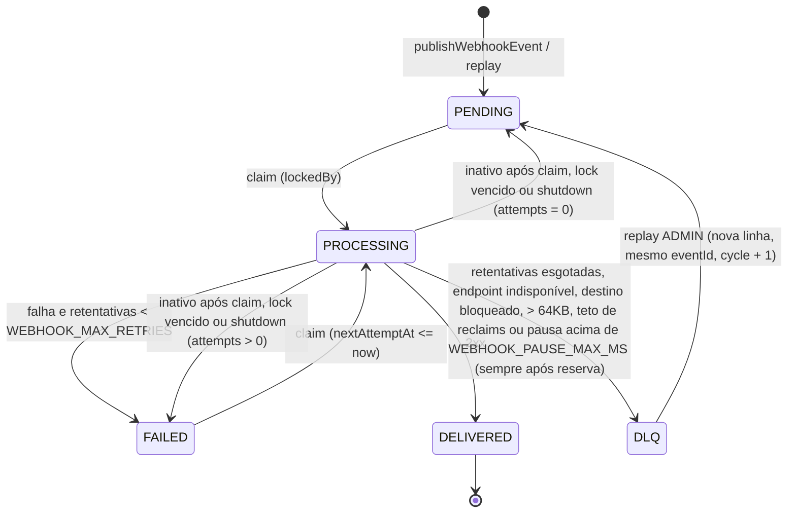

# FDD: Sistema de Webhooks de Notificação de Pedidos

| Campo | Valor |
|---|---|
| **Versão** | 1.1. A versão 1.0 (20/10/2026) foi alinhada ao modelo de FDD do curso, sem mudar decisões. |
| **Data** | 26/10/2026 |
| **Responsável** | Larissa (Tech Lead), que se comprometeu a abrir o documento de design da feature ([09:50] Larissa). *(Interpretação: o RFC e este FDD, juntos, cumprem esse compromisso.)* |
| **Status** | Em revisão técnica pelo time (sessão com Bruno e Diego, [09:50] Larissa). O [RFC](RFC.md) ainda está em revisão e a revisão de segurança está pendente ([RFC-OQ-04](RFC.md#questões-em-aberto)). |
| **Autoria** | @jeancsbnu, com apoio de IA |
| **Base** | [RFC](RFC.md), [ADR-001 a ADR-007](adrs/README.md), [PRD](PRD.md), [`TRANSCRICAO.md`](../TRANSCRICAO.md) e o código do repositório |

**Legenda.** Cada afirmação deste documento traz uma marca de origem:

- `[hh:mm] Nome`: decisão tomada na reunião.
- **(proposta)**: detalhe que a reunião não definiu, sempre com a justificativa ao lado.
- *(interpretação, AMB-xx)*: leitura adotada para um ponto ambíguo da transcrição, registrada em [`docs/processo/inventario.md`](processo/inventario.md#8-ambiguidades-e-interpretações-adotadas).
- **(novo)**: arquivo que ainda não existe no repositório.
- *(avaliação do autor)*: julgamento do redator, como plano de contingência e prioridade de risco.

**Relógio.** Toda comparação e todo agendamento de tempo feito pelo worker e pelos serviços usa o relógio do banco, `UTC_TIMESTAMP(3)` (proposta). Isso evita misturar o relógio do processo com o do MySQL. O Prisma grava `DateTime` em UTC.

**Pseudo-código.** Os trechos de SQL e as chamadas Prisma deste documento são pseudo-código. Expressões com `UTC_TIMESTAMP(3)` rodam via `$executeRaw`/`$queryRaw`. Quando uma operação usar o Prisma Client, o horário é lido do banco (`SELECT UTC_TIMESTAMP(3)`) no início do ciclo ou da requisição e passado como valor. Em `$queryRaw`, `COUNT()` e agregações retornam `BigInt` e os booleanos retornam 0 ou 1.

---

## 1. Contexto e motivação técnica

Clientes B2B querem saber quando o status de seus pedidos muda, e esperam isso em menos de 10 segundos ([09:00] Marcos, [09:02] Marcos).

O código atual não tem nenhum mecanismo para isso:

- não existem eventos, filas nem chamadas HTTP de saída;
- os módulos montados em `src/routes/index.ts` são apenas `auth`, `users`, `customers`, `products` e `orders`;
- o `package.json` não traz cliente HTTP.

O ponto de origem do evento é `OrderService.changeStatus` (`src/modules/orders/order.service.ts`). Esse método roda uma transação interativa (`this.prisma.$transaction(async (tx) => …)`) com cinco passos:

1. carrega o pedido com os itens;
2. valida a transição com `canTransition` (`src/modules/orders/order.status.ts`);
3. debita ou repõe o estoque;
4. atualiza `orders`;
5. grava `order_status_history`.

Bruno chamou essa transação de "pesada" ([09:04] Bruno). Uma chamada HTTP dentro dela travaria a mudança de status, e uma falha no cliente forçaria rollback ([09:04] Bruno).

Por isso a solução separa duas coisas ([ADR-001](adrs/ADR-001-outbox-no-mysql.md), [ADR-002](adrs/ADR-002-worker-separado-em-polling.md)):

- **registro transacional:** o evento entra numa outbox, dentro da mesma transação da mudança de status;
- **envio assíncrono:** um worker separado lê a outbox e faz as chamadas.

### Suposições e restrições

| ID | Tipo | Item | Origem |
|---|---|---|---|
| FDD-SUP-01 | Suposição | Um único worker ativo dá conta do volume atual *(hipótese: a reunião não discutiu volume)*. Escalar para vários é "problema do futuro". | [09:13] Diego |
| FDD-SUP-02 | Suposição | O volume lido a cada poll cabe num "batch pequeno". | [09:08] Diego |
| FDD-SUP-03 | Suposição | O cliente expõe um endpoint https e responde dentro de 10s. | [09:23] Sofia, [09:42] Diego |
| FDD-RST-01 | Restrição | Nenhuma infraestrutura nova. Nenhuma dependência npm nova é *(interpretação)* do "reuso máximo". | [09:29] Bruno, [09:30] Larissa |
| FDD-RST-02 | Restrição | A integração com `changeStatus` é uma função que recebe o `tx`, sem repository injetado, e o construtor de `OrderService` não muda. A única outra mudança no método é o parâmetro opcional `requestId` (proposta, FDD-INT-02). | [09:41] Bruno, [09:41] Diego |
| FDD-RST-03 | Restrição | Payload de até 64KB, tempo limite de 10s por envio e URL https. | [09:23] Sofia, [09:24] Larissa, [09:42] Diego |
| FDD-RST-04 | Restrição | Ids em UUID, como no resto do projeto. | [09:51] Larissa |
| FDD-RST-05 | Restrição | Prazo de 3 sprints, com a revisão de segurança no fim (plano na seção 14). | [09:47] Larissa |

## 2. Objetivos técnicos

| ID | Objetivo | Medida | Origem |
|---|---|---|---|
| FDD-OBJ-01 | Toda mudança de status com webhook inscrito gera evento de forma atômica | Nenhum status alterado sem evento e nenhum evento sem status alterado | [09:40] Bruno, [09:41] Diego |
| FDD-OBJ-02 | Primeiro envio rápido | Tempo do commit ao **início** do 1º envio abaixo de 10s *(interpretação, AMB-21)*. Monitorado pelo p95 (proposta de métrica), com atraso de polling de até ~2s. | [09:02] Marcos, [09:10] Larissa |
| FDD-OBJ-03 | A mudança de status não depende do cliente nem do que ele envia na requisição | Falha, lentidão ou dados vindos do cliente não alteram o resultado de `PATCH /api/v1/orders/:id/status` | [09:04] Bruno |
| FDD-OBJ-04 | Entrega resiliente e com fim definido | 5 tentativas com backoff ao longo de ~15h, lidas como 5 retentativas depois do envio inicial *(interpretação, AMB-02)*. Depois disso, DLQ com replay manual. Nenhum evento fica pendente para sempre. | [09:17] Larissa, [09:18] Diego |
| FDD-OBJ-05 | Origem e integridade verificáveis pelo cliente | HMAC-SHA256, secret por endpoint, rotação sem downtime | [09:22] Sofia |
| FDD-OBJ-06 | Nenhuma infraestrutura nova | Mesmo MySQL, Prisma e Pino; nenhuma dependência npm nova | [09:07] Diego, [09:30] Larissa |

## 3. Escopo e exclusões

**Dentro do escopo:**

- módulo `src/modules/webhooks/` (novo), com:
  - CRUD de cadastro;
  - histórico de entregas;
  - rotação de secret;
  - replay e listagem da DLQ;
- função `publishWebhookEvent`, chamada por `changeStatus`;
- worker `src/worker.ts` (novo), iniciado por `npm run worker`;
- tabelas e migration;
- testes.

**Fora do escopo** (nenhum código nesta entrega):

| Item excluído | Origem |
|---|---|
| E-mail de aviso | [09:37] Larissa |
| Dashboard visual para o cliente | [09:40] Larissa |
| Webhooks de entrada (inbound) | [09:02] Marcos |
| Arquivamento de linhas entregues | [09:08] Diego |
| Itens do pedido no payload | [09:43] Diego |
| Vários workers processando em paralelo | [09:13] Diego |
| Ordem global e entrega exatamente uma vez | [09:13] Larissa, [09:25] Diego |
| Eventos além de `order.status_changed` | [09:43] Diego, *AMB-11* |

A criação de pedido (`create` em `order.service.ts`) **não** publica evento.

**Em observação, sem implementação nesta fase:** o rate limiting de saída ficou para "observar e decidir depois" ([09:39] Larissa) e está registrado como questão em aberto ([RFC-OQ-01](RFC.md#questões-em-aberto)). As métricas da seção 9 servem de insumo para essa decisão.

---

## 4. Modelo de dados (proposto)

Colunas, tipos e índices são **(proposta)**. Três pontos vêm da reunião:

- os nomes das tabelas `webhook_outbox` ([09:06] Diego) e `webhook_dead_letter` ([09:18] Diego);
- os ids em UUID ([09:51] Larissa);
- os índices de status e `created_at` da outbox ([09:08] Diego).

As convenções seguem `prisma/schema.prisma`: `@db.Char(36)` para uuid, `@@map` em snake_case e colunas em camelCase.

```prisma
enum WebhookOutboxStatus {
  PENDING      // aguardando 1º envio do ciclo
  PROCESSING   // reservado por um worker (lockedBy)
  FAILED       // última tentativa falhou; aguarda nextAttemptAt (AMB-13)
  DELIVERED    // cliente respondeu 2xx
}

model WebhookEndpoint {                       // FDD-MOD-01
  id                      String    @id @default(uuid()) @db.Char(36)
  customerId              String    @db.Char(36)
  url                     String    @db.VarChar(2048)
  statuses                Json      // OrderStatus[] que o webhook quer receber
  secret                  String    @db.VarChar(128)
  previousSecret          String?   @db.VarChar(128)
  previousSecretExpiresAt DateTime?
  active                  Boolean   @default(true)
  deactivatedAt           DateTime?
  deletedAt               DateTime?
  createdAt               DateTime  @default(now())
  updatedAt               DateTime  @updatedAt

  customer Customer @relation(fields: [customerId], references: [id], onDelete: Cascade)

  @@index([customerId])
  @@map("webhook_endpoints")
}

model WebhookOutbox {                         // FDD-MOD-02
  id                String              @id @db.Char(36)   // = event_id = X-Event-Id
  webhookEndpointId String              @db.Char(36)       // sem FK
  orderId           String              @db.Char(36)       // sem FK (ADR-007)
  eventType         String              @db.VarChar(64)    // "order.status_changed"
  payload           String              @db.MediumText     // JSON serializado (snapshot)
  status            WebhookOutboxStatus @default(PENDING)
  cycle             Int                 @default(1)        // 1 = original; +1 a cada replay
  attempts          Int                 @default(0)        // envios feitos no ciclo
  nextAttemptAt     DateTime            @default(now())
  lockedBy          String?             @db.VarChar(64)    // holderId do worker que reservou
  claimId           String?             @db.Char(36)       // token da reserva (um por lote)
  lockedAt          DateTime?
  reclaims          Int                 @default(0)        // devoluções por lock vencido
  wasPaused         Boolean             @default(false)    // ficou retido por endpoint inativo
  lastError         String?             @db.VarChar(500)
  correlationId     String?             @db.VarChar(64)    // X-Request-Id saneado
  replayedFromId    String?             @db.Char(36)       // webhook_dead_letter.id, se replay
  deliveredAt       DateTime?
  createdAt         DateTime            @default(now())
  updatedAt         DateTime            @updatedAt

  @@index([status, createdAt])
  @@index([status, nextAttemptAt])
  @@index([webhookEndpointId, status, createdAt])
  @@map("webhook_outbox")
}

model WebhookDeadLetter {                     // FDD-MOD-03
  id                String    @id @default(uuid()) @db.Char(36)
  eventId           String    @db.Char(36)
  webhookEndpointId String    @db.Char(36)
  orderId           String    @db.Char(36)
  eventType         String    @db.VarChar(64)
  payload           String    @db.MediumText
  cycle             Int
  reasonCode        String    @db.VarChar(64)   // ex.: WEBHOOK_RETRIES_EXHAUSTED
  reason            String    @db.VarChar(500)  // motivo legível (último erro)
  attempts          Int
  failedAt          DateTime  @default(now())
  replayedAt        DateTime?
  replayedById      String?   @db.Char(36)

  @@index([webhookEndpointId, failedAt])
  @@index([eventId])
  @@map("webhook_dead_letter")
}

model WebhookDelivery {                       // FDD-MOD-04
  id                String   @id @default(uuid()) @db.Char(36)
  webhookEndpointId String   @db.Char(36)
  eventId           String   @db.Char(36)
  cycle             Int                        // ciclo do evento (replays incrementam)
  attempt           Int                        // 1 = envio inicial do ciclo; 0 = saída terminal sem envio
  requestBody       String   @db.MediumText
  responseStatus    Int?
  responseBody      String?  @db.VarChar(2048) // lido até 2KB
  startedAt         DateTime                   // início do envio (ou da decisão terminal)
  durationMs        Int
  dispatchDelayMs   Int?                       // só no 1º envio, ciclo 1, sem pausa
  success           Boolean
  errorCode         String?  @db.VarChar(64)
  createdAt         DateTime @default(now())

  @@index([webhookEndpointId, startedAt])
  @@map("webhook_deliveries")
}

model WebhookWorkerLease {                    // FDD-MOD-05
  id        Int      @id @default(1)           // linha única
  holderId  String?  @db.VarChar(64)
  expiresAt DateTime @default(now())

  @@map("webhook_worker_lease")
}
```

### FDD-MOD-01: `webhook_endpoints`

Guarda a URL, a secret, o customer e o "estado ativo" ([09:21] Bruno, [09:21] Sofia).

- `statuses` usa `Json`, porque o MySQL não tem tipo array.
- `previousSecret` e `previousSecretExpiresAt` implementam a carência de 24h ([09:21] Sofia).
- `deactivatedAt` marca o início de uma pausa (FDD-RES-12).
- `deletedAt` permite **remoção lógica** (proposta). Assim, histórico e DLQ continuam consultáveis.
- A FK para `customers` usa `onDelete: Cascade` (proposta):
  - O `DELETE /api/v1/customers/:id` é físico (`delete` em `src/modules/customers/customer.service.ts`).
  - Para customers com pedidos, ele já falha hoje, porque `Order.customer` não tem cascata em `prisma/schema.prisma`.
  - Para customers **sem** pedidos, uma FK restritiva de webhooks criaria uma falha nova. O Prisma lançaria P2003, que `src/middlewares/error.middleware.ts` não trata, e a resposta seria 500.

### FDD-MOD-02: `webhook_outbox`

Uma linha por webhook inscrito *(interpretação, AMB-04)*.

- O `id` é o próprio `event_id`, reaproveitado no replay *(interpretação, AMB-19)*.
- `payload` usa `MediumText`:
  - o `TEXT` do MySQL só comporta 65.535 bytes e impediria aplicar o limite de 64KB (AMB-03);
  - o conteúdo não é normalizado pelo banco ([ADR-007](adrs/ADR-007-payload-snapshot-na-insercao.md)).
- `lockedBy` identifica a instância, e `claimId` identifica **cada reserva** (lote). Toda confirmação e toda gravação posterior usam a guarda `lockedBy = :me AND claimId = :claimId` (a "guarda de reserva"). Assim, duas tarefas da mesma instância nunca disputam as mesmas linhas.
- `cycle` separa as tentativas de cada replay.
- `reclaims` limita quantas vezes uma linha presa volta à fila (FDD-RES-07).
- `wasPaused` tira da métrica de atraso os eventos que ficaram retidos por pausa.
- Não há FK para `orders` (ADR-007) nem para `webhook_endpoints`. Assim, os eventos pendentes sobrevivem à remoção física de um customer em cascata e são levados à DLQ com rastro.

### FDD-MOD-03: `webhook_dead_letter`

Guarda "a payload, motivo da falha e timestamp" ([09:18] Diego). `replayedAt` e `replayedById` registram quem fez o replay *(interpretação, AMB-18)*.

### FDD-MOD-04: `webhook_deliveries`

Uma linha por tentativa *(interpretação, AMB-05)*. Atende ao pedido de "sucesso/falha, payload, response, tempo de resposta" ([09:34] Marcos).

- As saídas terminais **sem envio** também geram uma linha, com `attempt = 0` e o respectivo `errorCode`. São elas: payload grande demais, endpoint indisponível, destino bloqueado e erro interno com teto de recuperações atingido. Assim, o dono do webhook vê essas saídas no próprio histórico.

### FDD-MOD-05: `webhook_worker_lease`

Linha única que garante uma só instância ativa do worker ([09:12] Diego). A migration cria a linha, e o worker também a cria na partida com `INSERT IGNORE` (FLUXO-02).

---

## 5. Fluxos detalhados

### FDD-FLUXO-01: Publicação do evento na transação de `changeStatus`



1. **Ponto da chamada.** A publicação acontece na mesma transação ([09:40] Bruno), por meio de uma função que recebe o `tx` ([09:41] Bruno, [09:41] Diego). O ponto exato é proposta: depois de `tx.orderStatusHistory.create(...)` e antes da releitura `refreshed`, para que um erro aqui ainda desfaça tudo (FDD-INT-01).
2. **Filtro na inserção.** A função busca os endpoints **ativos e não removidos** do `order.customerId` cujo `statuses` contém o status de destino. Se não houver nenhum, nada é inserido ([09:34] Bruno). Consequência: enquanto um cadastro está inativo, as mudanças de status do período **não geram evento** para ele.
3. **Payload.** É montado a partir do `order` já carregado pela transação, no formato de [FDD-CONTRATO-09](#fdd-contrato-09-contrato-de-saída-post-ao-endpoint-do-cliente) ([09:43] Diego, [09:52] Larissa).
4. **Falha (proposta).** Se a consulta ou o `INSERT` falhar:
   - a função grava `logger.error({ err, orderId, toStatus }, 'webhook_publish_failed')`, preservando a causa original;
   - em seguida lança `WEBHOOK_PUBLISH_FAILED` com mensagem genérica;
   - a exceção dentro de `$transaction` desfaz também a mudança de status e o estoque ([09:40] Bruno).
5. **Correlação (proposta).**
   - `correlationId` recebe o `X-Request-Id` **apenas** se ele casar com `^[A-Za-z0-9._-]{1,64}$`. Caso contrário, fica `null`.
   - O motivo: o header vem do cliente sem validação (`src/middlewares/request-logger.middleware.ts`). Sem esse saneamento, um valor longo derrubaria a mudança de status.

### FDD-FLUXO-02: Ciclo do worker

O worker tem **três rotinas**: heartbeat do lease, poll e tarefas por endpoint (proposta). O desenho busca três garantias:

- um único worker ativo ([09:12] Diego);
- ordem preservada por endpoint, inclusive quando uma instância substitui outra;
- nenhum endpoint, lento ou com muitos eventos acumulados, atrasando os demais ([ADR-002](adrs/ADR-002-worker-separado-em-polling.md), `ADR-002-CON-02`).



#### (a) Lease de instância única

1. **Identidade e partida.** No boot, o worker gera `holderId = crypto.randomUUID()` e executa:

   ```sql
   INSERT IGNORE INTO webhook_worker_lease (id, holderId, expiresAt)
   VALUES (1, NULL, UTC_TIMESTAMP(3))
   ```

   Isso garante que a linha exista. Sem ela, o worker ficaria em standby para sempre, sem distinguir esse caso de um lease ocupado por outra instância.
2. **Renovação.** Um timer próprio dispara a cada `WEBHOOK_LEASE_HEARTBEAT_MS` (10s) e executa via `$executeRaw`:

   ```sql
   UPDATE webhook_worker_lease
      SET holderId = :me,
          expiresAt = UTC_TIMESTAMP(3) + INTERVAL :ttlMs * 1000 MICROSECOND
    WHERE id = 1
      AND (holderId = :me OR holderId IS NULL OR expiresAt < UTC_TIMESTAMP(3))
   ```

   O `:ttlMs` vem de `WEBHOOK_LEASE_TTL_MS`, com padrão de 30s.
3. **Quando a instância está ativa.** Há duas condições, e as duas precisam valer ao mesmo tempo:
   - a última renovação afetou 1 linha;
   - pelo relógio monotônico do processo, `últimaRenovaçãoOk + TTL − 5s` ainda não passou (expiração local).

   Uma renovação que falha por exceção (banco indisponível) conta como não renovada. Ao perder qualquer uma das duas condições, a instância **para de iniciar tarefas e de reservar novos lotes**. A parada também é imediata quando o processo recebe `SIGTERM` ou `SIGINT`: a flag `stopping` (FDD-RES-09) bloqueia novos lotes e novas tarefas mesmo enquanto o lease ainda é válido. As tarefas em curso terminam o evento atual, e suas gravações continuam sujeitas à guarda de reserva (`lockedBy = :me AND claimId = :claimId`).
4. **Standby.** Uma instância sem lease fica em espera. Ela registra `webhook_worker_standby` e tenta de novo a cada heartbeat. Assim não entra em crash-loop sob um supervisor.
5. **Por que não `GET_LOCK()`.** O lock do MySQL vale por conexão, e o pool do Prisma não garante a mesma conexão entre chamadas.

#### (b) Poll

O poll roda a cada **2s** ([09:09] Diego, [09:10] Larissa), só enquanto a instância está ativa, e **não espera** as entregas. Ele **não é reentrante**: um novo poll só começa quando o anterior terminou a seleção e a reserva.

1. **Linhas presas.** Linhas `PROCESSING` com `lockedAt < UTC_TIMESTAMP(3) − WEBHOOK_STUCK_AFTER_MS` (padrão 5 min) são tratadas assim:
   - voltam a `PENDING` se `attempts = 0`, ou a `FAILED` caso contrário;
   - recebem `nextAttemptAt = UTC_TIMESTAMP(3)`, `lockedBy = NULL` e `reclaims = reclaims + 1`;
   - se `reclaims` atingir `WEBHOOK_MAX_RECLAIMS` (padrão 3), a linha primeiro é **reservada por esta instância** (`lockedBy = :me` com novo `claimId`, no mesmo UPDATE) e só depois movida para a DLQ com `WEBHOOK_DELIVERY_INTERNAL_ERROR` (FLUXO-05). A ordem importa porque a guarda do FLUXO-05 exige a reserva. Isso evita loop eterno de um evento que derruba o worker.

   A duplicata que pode surgir aqui é aceita pela semântica at-least-once ([09:24] Diego).
2. **Pausas longas.** Os eventos de endpoints inativos há mais de `WEBHOOK_PAUSE_MAX_MS` (padrão 24h, contados de `deactivatedAt`) são reservados (`lockedBy = :me`, `claimId`) e então movidos para a DLQ com `WEBHOOK_ENDPOINT_UNAVAILABLE`. Assim nenhum evento fica parado para sempre (FDD-OBJ-04). Eles podem ser reprocessados por replay depois de o cadastro ser reativado.
3. **Capacidade.** O número de vagas livres é `livres = WEBHOOK_CONCURRENCY (padrão 10) − tarefas em curso`. Se não houver vaga, o poll termina aqui.
4. **Seleção justa por endpoint, em duas etapas.** As consultas trabalham só com colunas estreitas e usam o índice `(webhookEndpointId, status, createdAt)`, sem ler `payload`.

   **Etapa 1: quais endpoints têm trabalho.**

   ```sql
   SELECT o.webhookEndpointId, MIN(o.createdAt) AS oldest
     FROM webhook_outbox o
     LEFT JOIN webhook_endpoints e ON e.id = o.webhookEndpointId
    WHERE (o.status = 'PENDING' OR (o.status = 'FAILED' AND o.nextAttemptAt <= UTC_TIMESTAMP(3)))
      AND NOT (e.id IS NOT NULL AND e.active = 0 AND e.deletedAt IS NULL)      -- pausados ficam de fora
      AND NOT EXISTS (SELECT 1 FROM webhook_outbox p                            -- ocupado no banco
                       WHERE p.webhookEndpointId = o.webhookEndpointId AND p.status = 'PROCESSING')
    GROUP BY o.webhookEndpointId
   ```

   **Etapa 2: o lote de cada endpoint escolhido.**

   ```sql
   SELECT id FROM webhook_outbox
    WHERE webhookEndpointId = :endpoint
      AND (status = 'PENDING' OR (status = 'FAILED' AND nextAttemptAt <= UTC_TIMESTAMP(3)))
    ORDER BY createdAt
    LIMIT :perEndpoint
   ```

   O que as duas etapas garantem:
   - **Exclusões feitas no SQL.** Endpoints pausados e ocupados saem **antes** de qualquer escolha.
   - **Órfãos continuam elegíveis.** O `LEFT JOIN` mantém linhas de endpoint ausente ou removido, que seguem para a DLQ (FLUXO-03).
   - **"Ocupado" vale entre instâncias.** Ocupado significa ter linha em `PROCESSING` no banco **ou** ter tarefa viva no conjunto em memória `busyEndpoints` desta instância. O banco cobre a troca de instância: a nova não toca um endpoint com linhas reservadas pela anterior. A memória cobre a janela entre um lote e o próximo da drenagem, quando o endpoint fica momentaneamente sem linhas `PROCESSING`.
   - **Justiça entre endpoints.** Cada endpoint contribui com até `WEBHOOK_PER_ENDPOINT_BATCH` (padrão 5) linhas, então um backlog grande não ocupa a janela dos outros. O custo da etapa 1 é uma varredura só de índice (sem `payload`) proporcional ao backlog elegível, o que é aceitável em milissegundos para dezenas de milhares de linhas. Ver FDD-RISK-15.

   No código, o poll descarta os endpoints que estão em `busyEndpoints` e ordena os restantes por **último atendimento** (mapa em memória `lastServedAt`, os nunca atendidos primeiro) e, em caso de empate, por `oldest`. Em seguida fica com os **`livres` primeiros**. O rodízio evita que endpoints com backlog antigo voltem sempre na frente.
5. **Reserva por endpoint.** Para cada endpoint escolhido, o poll:
   - inclui o endpoint em `busyEndpoints` **antes** de reservar;
   - gera um `claimId = crypto.randomUUID()`;
   - reserva as linhas e confirma o que de fato ficou com ele:

   ```sql
   -- reserva
   UPDATE … SET status = 'PROCESSING', lockedBy = :me, claimId = :claimId, lockedAt = UTC_TIMESTAMP(3)
    WHERE id IN (…) AND status IN ('PENDING', 'FAILED')

   -- confirmação
   SELECT … WHERE lockedBy = :me AND claimId = :claimId AND status = 'PROCESSING'
    ORDER BY createdAt
   ```

   Como o `claimId` é único por reserva, duas reservas da mesma instância nunca confirmam as mesmas linhas.
6. **Despacho.** O poll inicia uma **tarefa por endpoint**, sem `await`, e devolve as promessas dessas tarefas. A tarefa tira o endpoint de `busyEndpoints` só ao terminar e grava `lastServedAt`.

#### (c) Tarefa por endpoint

1. **Entrega em ordem.** A tarefa entrega as linhas reservadas **uma por vez, em ordem de `createdAt`** (FLUXO-03).
2. **Drenagem.** Quando o lote acaba e a instância continua ativa, a tarefa reserva **imediatamente** o próximo lote do mesmo endpoint, com a etapa 2 da seleção e um novo `claimId`. Ela segue assim enquanto as três condições abaixo valerem:
   - ainda há linhas elegíveis;
   - não processou `WEBHOOK_TASK_MAX_EVENTS` (padrão 50) eventos;
   - não passou de `WEBHOOK_TASK_MAX_MS` (padrão 30s).

   A **primeira falha** do lote (timeout, erro de rede, não-2xx ou erro interno) também encerra a drenagem. Nesse caso, as linhas já reservadas e ainda não iniciadas voltam ao estado anterior, sem consumir tentativa, e o endpoint só volta a ser atendido num poll seguinte. Assim, um endpoint que não responde ocupa uma vaga por no máximo ~10s por poll, e não 50 × 10s. Um endpoint saudável não fica preso ao intervalo do poll.
3. **Ordem e backoff.** Como os eventos de um pedido para um mesmo endpoint passam sempre pela mesma tarefa, a ordem por pedido se mantém no primeiro envio ([09:12] Diego). Um evento em backoff não segura os posteriores *(interpretação, AMB-09)*.
4. **Erros inesperados.** A tarefa envolve cada evento em `try/catch` total. Qualquer exceção fora das classes previstas (URL inválida gravada fora da API, erro de banco, falha de stream) vira uma tentativa com falha `WEBHOOK_DELIVERY_INTERNAL_ERROR`, que consome tentativa e segue o backoff (FLUXO-04). A linha nunca fica presa *(interpretação, AMB-20)*.

#### (d) Testabilidade

**(proposta)** O módulo do worker exporta funções que os testes podem chamar diretamente:

| Função | O que faz |
|---|---|
| `acquireOrRenewLease()` | Adquire ou renova o lease |
| `runPollOnce()` | Executa um poll e devolve as promessas das tarefas iniciadas, para que o teste use `await` |
| `drain()` | Aguarda todas as tarefas em curso |
| `shutdown()` | Encerra o worker |

O tempo é controlado pelo banco. Os testes avançam o relógio ajustando `nextAttemptAt`, `lockedAt`, `expiresAt`, `deactivatedAt` e `previousSecretExpiresAt` direto nas linhas. Já os prazos de rede (`WEBHOOK_HTTP_TIMEOUT_MS`, TTL do lease) são reduzidos por variável de ambiente.

O destino de teste é um servidor **HTTPS** local com certificado autoassinado, cuja CA é injetada com `NODE_EXTRA_CA_CERTS` **no script npm de teste** (`NODE_EXTRA_CA_CERTS=… vitest run`). O Node só lê essa variável na partida do processo, e os forks do vitest herdam o ambiente do processo pai; definir a variável em `tests/setup.ts` não teria efeito. Os testes rodam com `WEBHOOK_ALLOW_PRIVATE_DESTINATIONS=true`, que libera loopback e redes privadas. O `superRefine` do env **proíbe** essa flag com `NODE_ENV=production`. O AC-24, que verifica o bloqueio, roda com a flag desligada. Essas funções ficam em `src/modules/webhooks/webhook.worker.ts` (novo; o nome é *interpretação, AMB-12*). O arquivo `src/worker.ts` (novo) faz apenas o bootstrap e agenda essas funções.

### FDD-FLUXO-03: Entrega de um evento



1. **Situação do endpoint (proposta).**
   - Cadastro inexistente (removido em cascata com o customer) ou removido (`deletedAt`): o evento vai para a DLQ com `WEBHOOK_ENDPOINT_UNAVAILABLE`.
   - Cadastro que ficou **inativo** entre o claim e a entrega: a linha volta sem consumir tentativa e é marcada com `wasPaused = true`. O poll não seleciona linhas de endpoints inativos, então o evento fica **pausado** até a reativação, ou até o limite de pausa (FLUXO-02(b) passo 2).
2. **Tamanho.** Corpo com **mais de 65.536 bytes** vai direto para a DLQ com `WEBHOOK_PAYLOAD_TOO_LARGE`, sem envio. Até 65.536 bytes, o envio segue normalmente ([09:23] Sofia, [09:24] Larissa; *(interpretação, AMB-03)*).
3. **Assinatura.** É calculada **no envio**, sobre os bytes gravados, com a `secret` atual. Se `previousSecretExpiresAt > UTC_TIMESTAMP(3)`, usa também a `previousSecret` ([ADR-007](adrs/ADR-007-payload-snapshot-na-insercao.md); *(interpretação, AMB-25)*). O formato está em [FDD-CONTRATO-09](#fdd-contrato-09-contrato-de-saída-post-ao-endpoint-do-cliente).
4. **Destino e envio (proposta, sujeita à revisão de segurança).** O envio usa `node:https.request`, nativo do Node ≥ 20 (`package.json`), com uma função `lookup` própria. Essa função:
   - resolve o host;
   - **recusa** endereços de loopback, de redes privadas, link-local e de metadata (ex.: `169.254.169.254`);
   - **fixa** o IP validado na conexão, o que impede DNS rebinding entre a checagem e a conexão.

   Cuidados de implementação no Node 20:
   - **`lookup` com `{ all: true }`.** Com `autoSelectFamily` ligado, o `lookup` é chamado com `{ all: true }` e deve devolver um array. **Todos** os endereços resolvidos são validados: basta um bloqueado para recusar o destino inteiro, sem filtrar em silêncio.
   - **IP literal.** Quando o host já é um IP, o `net.connect` não chama `lookup`. Por isso o worker testa `net.isIP(hostname)` antes do `request` e valida o literal. A URL gravada no banco pode não ter passado pelo Zod.
   - **Faixas bloqueadas:**
     - IPv4: `0.0.0.0/8`, `10.0.0.0/8`, `100.64.0.0/10`, `127.0.0.0/8`, `169.254.0.0/16`, `172.16.0.0/12` e `192.168.0.0/16`;
     - IPv6: `::`, `::1`, `fc00::/7` e `fe80::/10`;
     - IPv4 mapeado em IPv6 (`::ffff:0:0/96`) é validado pelo IPv4 embutido.
   - **Timeout.** O abort chega como `AbortError`. A tarefa classifica pelo `signal.reason`: `TimeoutError` vira `WEBHOOK_DELIVERY_TIMEOUT`, e os demais erros viram `WEBHOOK_DELIVERY_NETWORK_ERROR`.
   - **Ambiente de teste.** Com `WEBHOOK_ALLOW_PRIVATE_DESTINATIONS=true`, o bloqueio é desligado. A flag é proibida em produção (FDD-INT-12).

   Um único `AbortSignal.timeout(WEBHOOK_HTTP_TIMEOUT_MS)` (padrão **10s**, [09:42] Diego) cobre a resolução DNS, a conexão e a resposta. O worker não segue redirecionamentos: um 3xx conta como falha. O corpo da resposta é lido em stream até 2KB, e o restante é descartado. Destino recusado resulta em `WEBHOOK_DESTINATION_BLOCKED` e vai direto para a DLQ.

   A troca de `fetch` por `https.request` é deliberada: o `fetch` nativo resolve o DNS de novo por conta própria, e fixar o IP com ele exigiria o `dispatcher` do undici, uma dependência nova.
5. **Classificação.**
   - 2xx → `DELIVERED`.
   - Timeout, erro de rede, status fora de 2xx ou exceção interna → falha *(interpretação, AMB-17)*.
6. **Registro.** Toda tentativa grava uma linha em `webhook_deliveries` com `cycle`, `attempt`, `startedAt`, `durationMs`, `responseStatus`, `responseBody` (até 2KB) e `errorCode`.
   - `dispatchDelayMs` (`startedAt − outbox.createdAt`) só é preenchido quando valem as três condições: `attempt = 1`, `cycle = 1` e `wasPaused = false`.
   - As saídas terminais sem envio dos itens 1, 2 e 4, e o teto de reclaims, também gravam uma linha com `attempt = 0` (FDD-MOD-04). Essa gravação acontece **dentro da mesma transação** que move o evento para a DLQ (FLUXO-05).
7. **Guarda de reserva.** Toda atualização da outbox depois do envio usa `WHERE id = :id AND lockedBy = :me AND claimId = :claimId`. Se a atualização afetar 0 linhas, a reserva foi perdida (lock vencido e devolvido, ou instância substituída):
   - a tarefa registra `webhook_lock_lost`;
   - **abandona** a linha sem gravar nada nela;
   - mantém a linha de `webhook_deliveries`, porque o envio de fato aconteceu.

### FDD-FLUXO-04: Retentativa com backoff

Intervalos definidos na reunião ([09:17] Diego, [09:17] Larissa). A contagem de 5 retentativas depois do envio inicial é *(interpretação, AMB-02)*.

| Envio | `attempts` depois do envio | Se falhar |
|---|---|---|
| 1º (inicial) | 1 | `FAILED`, `nextAttemptAt = UTC_TIMESTAMP(3) + 1 min` |
| 2º (retentativa 1) | 2 | `FAILED`, `+ 5 min` |
| 3º (retentativa 2) | 3 | `FAILED`, `+ 30 min` |
| 4º (retentativa 3) | 4 | `FAILED`, `+ 2 h` |
| 5º (retentativa 4) | 5 | `FAILED`, `+ 12 h` |
| 6º (retentativa 5) | 6 | DLQ (`WEBHOOK_RETRIES_EXHAUSTED`) |

- A janela da 1ª falha até a última tentativa é de 14h36min, mais o atraso do polling ("quase 15 horas", [09:17] Diego).
- Os intervalos ficam numa constante do módulo, e o teto vem de `WEBHOOK_MAX_RETRIES=5`. A partida valida que o número de intervalos é igual ao teto (FDD-INT-12).



### FDD-FLUXO-05: Movimentação para a DLQ

O evento é **movido** *(interpretação, AMB-13)* em uma única transação Prisma, nesta ordem:

1. `DELETE webhook_outbox WHERE id = :eventId AND lockedBy = :me AND claimId = :claimId`. Toda movimentação para a DLQ, inclusive a de pausa expirada e a de teto de reclaims, acontece sobre uma linha já reservada por esta instância.
2. **Se o DELETE afetou 1 linha:**
   - `INSERT webhook_dead_letter` com `eventId`, `webhookEndpointId`, `orderId`, `eventType`, `payload`, `cycle`, `reasonCode`, `reason` (último erro), `attempts` e `failedAt = UTC_TIMESTAMP(3)` ([09:18] Diego);
   - nas saídas sem envio, mais o `INSERT webhook_deliveries` com `attempt = 0`.
3. **Se o DELETE afetou 0 linhas** (reserva perdida): a transação é desfeita e a tarefa registra `webhook_lock_lost`. Assim, o mesmo evento nunca fica na outbox e na DLQ ao mesmo tempo.
4. Log `webhook_moved_to_dead_letter` ([FDD-OBS-01](#fdd-obs-01-logs)).

As tentativas já registradas em `webhook_deliveries` continuam no histórico.

### FDD-FLUXO-06: Replay manual da DLQ

**Rota e acesso.** `POST /api/v1/admin/webhooks/dead-letter/:id/replay`, com `authenticate` e `requireRole('ADMIN')` ([09:18] Diego, [09:36] Sofia, [09:36] Larissa).

**Passos.** Tudo acontece numa transação:

1. Lê o item. Se não existir → `WEBHOOK_DEAD_LETTER_NOT_FOUND`.
2. Se `reasonCode = WEBHOOK_PAYLOAD_TOO_LARGE`, recusa com 422 e o mesmo código, porque o corpo é imutável e o envio falharia de novo (proposta).
   - Itens com `WEBHOOK_DESTINATION_BLOCKED` **são aceitos**: a URL é lida no envio e pode ter sido corrigida por `PATCH`. O destino é reavaliado na entrega.
3. Se o cadastro foi removido, não existe ou está **inativo** → `WEBHOOK_ENDPOINT_UNAVAILABLE`. O replay exige cadastro ativo: com cadastro inativo, o evento voltaria para a DLQ no poll seguinte pela regra de pausa expirada, porque a pausa é contada a partir do `deactivatedAt` do cadastro.
4. Executa `updateMany({ where: { id, replayedAt: null }, data: { replayedAt: UTC_TIMESTAMP(3), replayedById: req.user.id } })`. Se `count = 0` → `WEBHOOK_DEAD_LETTER_ALREADY_REPLAYED`. Isso também cobre dois replays simultâneos.
5. Insere em `webhook_outbox`: `id` igual ao `eventId` original, mesmo `payload`, `cycle = deadLetter.cycle + 1`, `status = PENDING`, `attempts = 0`, `reclaims = 0`, `nextAttemptAt = UTC_TIMESTAMP(3)` e `replayedFromId = :id`. Ou seja, o evento é recolocado "na outbox como pendente" ([09:18] Diego), com o mesmo `event_id` *(interpretação, AMB-19)*. A linha da DLQ é marcada, não apagada.

**Auditoria.** O log `webhook_dead_letter_replayed` registra `deadLetterId`, `eventId`, `webhookId` e o `userId` do ADMIN ([09:36] Sofia; *(interpretação, AMB-18)*).

### FDD-FLUXO-07: Rotação de secret

**Rota.** `POST /api/v1/webhooks/:id/rotate-secret` ([09:21] Sofia). O path é *(interpretação, AMB-06)*.

**Fluxo normal (sem `revokePrevious`).**

1. A nova secret é gerada com `crypto.randomBytes(32)` em base64url, o que dá 43 caracteres (proposta).
2. Uma **única** atualização condicionada faz a rotação:

   ```sql
   UPDATE webhook_endpoints
      SET previousSecret = secret,
          previousSecretExpiresAt = UTC_TIMESTAMP(3) + INTERVAL 24 HOUR,
          secret = :nova,
          updatedAt = UTC_TIMESTAMP(3)
    WHERE id = :id
      AND deletedAt IS NULL
      AND (previousSecretExpiresAt IS NULL OR previousSecretExpiresAt <= UTC_TIMESTAMP(3))
   ```

   Isso preserva a carência de 24h ([09:21] Sofia).
3. Se a atualização afetar 0 linhas, um `SELECT` identifica o motivo:
   - cadastro inexistente ou removido → `404 WEBHOOK_NOT_FOUND`;
   - carência em curso → `409 WEBHOOK_SECRET_ROTATION_IN_PROGRESS` (proposta).
   - O 409 impede que uma segunda rotação, por retry ou duplo clique, invalide na hora a secret que o cliente ainda usa.
   - Como a checagem e a gravação são a mesma operação, dois pedidos simultâneos não passam juntos.

**Rotação de emergência (proposta, sujeita à revisão de segurança).** O body opcional `{ "revokePrevious": true }` força a rotação mesmo durante a carência:

- a secret anterior é **revogada na hora**: `previousSecret = NULL` e `previousSecretExpiresAt = NULL`;
- a secret atual é substituída pela nova **sem virar `previousSecret`**. Ou seja, mesmo fora de uma carência, a troca acontece de imediato, sem as 24h.

Esse caminho atende dois casos:

- a secret recém-gerada vazou (o histórico de [09:22] Diego);
- a resposta da rotação se perdeu e o cliente não conhece a secret nova.

O efeito colateral, explicado no contrato, é este: entregas assinadas com a secret anterior deixam de ser aceitas pelo cliente que ainda não migrou.

**Resposta e registro.**

- A nova secret aparece **uma única vez**, na resposta.
- O log `webhook_secret_rotated` registra `webhookId`, `userId` e `revokedPrevious`, e nunca a secret.

**Limpeza.** A cada poll, o worker executa `UPDATE … SET previousSecret = NULL, previousSecretExpiresAt = NULL WHERE previousSecretExpiresAt <= UTC_TIMESTAMP(3)`, para não manter em repouso uma secret que já expirou.

### FDD-FLUXO-08: CRUD de cadastro

- **Secret.** É gerada pela plataforma e devolvida na criação ([09:31] Marcos). Depois disso não aparece em nenhuma leitura *(interpretação, AMB-10)*.
- **`customerId`.** Vem no body do `POST` e na query do `GET`, nunca do JWT ([09:32] Larissa). Segue o padrão de `createOrderSchema` e `listOrdersQuerySchema` em `src/modules/orders/order.schemas.ts` *(interpretação, AMB-01)*.
- **Permissão.** O CRUD fica aberto a qualquer role autenticada, "por enquanto" ([09:37] Sofia).
- **Efeito de cada campo do `PATCH` (proposta):**

| Campo | Quando vale | Efeito |
|---|---|---|
| `statuses` | Só para eventos futuros, porque o filtro é aplicado na inserção ([ADR-001](adrs/ADR-001-outbox-no-mysql.md)) | Os eventos já registrados não mudam |
| `url` | Na hora do envio | Os eventos pendentes passam a ir para a URL nova |
| `active: false` | Imediatamente | Só na transição de `true` para `false` (`updateMany … WHERE active = true`): grava `deactivatedAt` e marca `wasPaused` nos pendentes. Repetir `active: false` não altera `deactivatedAt` e não estende o prazo. Os pendentes ficam **pausados** por até 24h (`WEBHOOK_PAUSE_MAX_MS`) e depois vão para a DLQ. Mudanças de status ocorridas durante a inatividade **não geram eventos** (FLUXO-01 item 2). |
| `active: true` | Imediatamente | Limpa `deactivatedAt` e retoma os pendentes que ainda não foram para a DLQ |

- **Remoção.** É lógica: `deletedAt = UTC_TIMESTAMP(3)` e `active = false` (proposta). Os eventos pendentes vão para a DLQ quando chegar a vez deles (FLUXO-03).

---

## 6. Contratos públicos

**Regras gerais (valem para todos os endpoints):**

- **Prefixo e autenticação.** Todos os endpoints ficam sob `/api/v1`, porque `src/app.ts` monta `app.use('/api/v1', …)`. Todos exigem `Authorization: Bearer <jwt>`, verificado por `authenticate`.
- **Envelope de erro.** Erros seguem o formato de `src/middlewares/error.middleware.ts`: `{ "error": { "code", "message", "details"? } }`.
- **Validação.** Falhas de schema Zod em body, params ou query retornam `400 VALIDATION_ERROR` com `details: [{ path, message }]` (`src/middlewares/validate.middleware.ts`). Isso inclui `:id` que não seja uuid.
- **Autenticação e permissão.** `401 UNAUTHORIZED` e `403 FORBIDDEN` vêm dos middlewares existentes.
- **Nomes de campo.** A API usa camelCase. O payload de saída para o cliente usa snake_case, como ditado em [09:43] Diego.
- **Paths novos.** Paths que não foram ditos na reunião estão marcados como (proposta).

### FDD-CONTRATO-01: `POST /api/v1/webhooks`

**Tipo:** endpoint HTTP. **Método:** POST. **Rota:** `/api/v1/webhooks`. **Acesso:** qualquer usuário autenticado.

Cadastra um webhook ([09:31] Marcos).

```http
POST /api/v1/webhooks
Authorization: Bearer eyJhbGciOi...
Content-Type: application/json

{
  "customerId": "0b6e5f0e-7d1c-4d7a-9a52-4b9f0d6a1c11",
  "url": "https://erp.cliente.example/webhooks/oms",
  "statuses": ["PROCESSING", "SHIPPED", "DELIVERED"]
}
```

```http
HTTP/1.1 201 Created
Content-Type: application/json

{
  "id": "3f2a9c1e-5b7d-4e8f-a012-6c3d4e5f6a7b",
  "customerId": "0b6e5f0e-7d1c-4d7a-9a52-4b9f0d6a1c11",
  "url": "https://erp.cliente.example/webhooks/oms",
  "statuses": ["PROCESSING", "SHIPPED", "DELIVERED"],
  "active": true,
  "secret": "q3V6m1x0yJcB8n2Lr9tW4kZpH7sD5fA1eG6uC0oI2vM",
  "previousSecretExpiresAt": null,
  "createdAt": "2026-11-03T14:00:00.000Z",
  "updatedAt": "2026-11-03T14:00:00.000Z"
}
```

**Validação (Zod, `webhook.schemas.ts`):**

| Campo | Regra |
|---|---|
| `customerId` | uuid |
| `url` | Exige protocolo `https:` ([09:23] Sofia). Uma URL `http:` retorna `400 VALIDATION_ERROR` com `details: [{ "path": "url", "message": "URL must use https" }]` *(interpretação, AMB-26)*. Também recusa `localhost` e IP literal privado, de loopback ou link-local, para dar retorno imediato ao cliente (proposta). A exceção é `WEBHOOK_ALLOW_PRIVATE_DESTINATIONS=true`, usada só em teste. A proteção definitiva acontece no envio (FLUXO-03 item 4). |
| `statuses` | Lista de status ([09:33] Marcos). Proposta: não pode ser vazia nem ter valores repetidos, e aceita valores de `OrderStatus` exceto `PENDING`. `PENDING` nunca é destino de transição (`src/modules/orders/order.status.ts`). |

**Respostas:**

| Status | Código | Quando |
|---|---|---|
| 201 | | Webhook criado |
| 400 | `VALIDATION_ERROR` | Corpo inválido |
| 401 | `UNAUTHORIZED` | Sem token válido |
| 404 | `WEBHOOK_CUSTOMER_NOT_FOUND` | `customerId` não existe |

A `secret` só aparece nesta resposta e na de rotação.

### FDD-CONTRATO-02: `GET /api/v1/webhooks?customerId=…`

**Tipo:** endpoint HTTP. **Método:** GET. **Rota:** `/api/v1/webhooks?customerId=`. **Acesso:** qualquer usuário autenticado.

Lista os webhooks de um customer ([09:33] Bruno), paginados com `paginated()` (`src/shared/http/response.ts`).

```http
GET /api/v1/webhooks?customerId=0b6e5f0e-7d1c-4d7a-9a52-4b9f0d6a1c11&page=1&pageSize=20
Authorization: Bearer eyJhbGciOi...
```

```http
HTTP/1.1 200 OK
Content-Type: application/json

{
  "data": [
    {
      "id": "3f2a9c1e-5b7d-4e8f-a012-6c3d4e5f6a7b",
      "customerId": "0b6e5f0e-7d1c-4d7a-9a52-4b9f0d6a1c11",
      "url": "https://erp.cliente.example/webhooks/oms",
      "statuses": ["PROCESSING", "SHIPPED", "DELIVERED"],
      "active": true,
      "previousSecretExpiresAt": null,
      "createdAt": "2026-11-03T14:00:00.000Z",
      "updatedAt": "2026-11-03T14:00:00.000Z"
    }
  ],
  "pagination": { "page": 1, "pageSize": 20, "total": 1, "totalPages": 1 }
}
```

**Query:**

| Parâmetro | Regra |
|---|---|
| `customerId` | uuid, obrigatório |
| `page` | ≥ 1, padrão 1 |
| `pageSize` | de 1 a 100, padrão 20 |

**Respostas:**

| Status | Código | Quando |
|---|---|---|
| 200 | | Lista retornada |
| 400 | `VALIDATION_ERROR` | Query inválida |
| 401 | `UNAUTHORIZED` | Sem token válido |

A listagem nunca traz a `secret` e não inclui cadastros removidos.

### FDD-CONTRATO-03: `PATCH /api/v1/webhooks/:id`

**Tipo:** endpoint HTTP. **Método:** PATCH. **Rota:** `/api/v1/webhooks/:id`. **Acesso:** qualquer usuário autenticado.

Edita um cadastro ([09:33] Bruno). Todos os campos são opcionais, mas é preciso enviar pelo menos um.

```http
PATCH /api/v1/webhooks/3f2a9c1e-5b7d-4e8f-a012-6c3d4e5f6a7b
Authorization: Bearer eyJhbGciOi...
Content-Type: application/json

{ "statuses": ["SHIPPED", "DELIVERED"] }
```

```http
HTTP/1.1 200 OK
Content-Type: application/json

{
  "id": "3f2a9c1e-5b7d-4e8f-a012-6c3d4e5f6a7b",
  "customerId": "0b6e5f0e-7d1c-4d7a-9a52-4b9f0d6a1c11",
  "url": "https://erp.cliente.example/webhooks/oms",
  "statuses": ["SHIPPED", "DELIVERED"],
  "active": true,
  "previousSecretExpiresAt": null,
  "createdAt": "2026-11-03T14:00:00.000Z",
  "updatedAt": "2026-11-04T10:00:00.000Z"
}
```

**Campos aceitos:**

| Campo | Regra |
|---|---|
| `url` | Mesmas regras do `POST` |
| `statuses` | Mesmas regras do `POST` |
| `active` | boolean ("estado ativo", [09:21] Bruno) |

**Respostas:**

| Status | Código | Quando |
|---|---|---|
| 200 | | Cadastro atualizado |
| 400 | `VALIDATION_ERROR` | Corpo ou `:id` inválido |
| 401 | `UNAUTHORIZED` | Sem token válido |
| 404 | `WEBHOOK_NOT_FOUND` | Cadastro inexistente ou removido |

**Semântica (FLUXO-08):**

- `statuses` vale só para eventos futuros.
- `url` vale também para os eventos pendentes.
- `active: false` tem dois efeitos:
  - pausa os pendentes por até 24h; depois disso eles vão para a DLQ;
  - **nenhum evento é gerado** para mudanças de status enquanto o cadastro estiver inativo.
- `active: true` retoma os pendentes.

### FDD-CONTRATO-04: `DELETE /api/v1/webhooks/:id`

**Tipo:** endpoint HTTP. **Método:** DELETE. **Rota:** `/api/v1/webhooks/:id`. **Acesso:** qualquer usuário autenticado.

Remove um cadastro ([09:33] Bruno).

```http
DELETE /api/v1/webhooks/3f2a9c1e-5b7d-4e8f-a012-6c3d4e5f6a7b
Authorization: Bearer eyJhbGciOi...
```

```http
HTTP/1.1 204 No Content
```

**Respostas:**

| Status | Código | Quando |
|---|---|---|
| 204 | | Cadastro removido |
| 400 | `VALIDATION_ERROR` | `:id` inválido |
| 401 | `UNAUTHORIZED` | Sem token válido |
| 404 | `WEBHOOK_NOT_FOUND` | Cadastro inexistente ou já removido |

A remoção é lógica (proposta). Os eventos pendentes vão para a DLQ com `WEBHOOK_ENDPOINT_UNAVAILABLE`.

### FDD-CONTRATO-05: `POST /api/v1/webhooks/:id/rotate-secret`

**Tipo:** endpoint HTTP. **Método:** POST. **Rota:** `/api/v1/webhooks/:id/rotate-secret`. **Acesso:** qualquer usuário autenticado.

Rotaciona a secret ([09:21] Sofia). O path é *(interpretação, AMB-06)*.

```http
POST /api/v1/webhooks/3f2a9c1e-5b7d-4e8f-a012-6c3d4e5f6a7b/rotate-secret
Authorization: Bearer eyJhbGciOi...
Content-Type: application/json

{}
```

```http
HTTP/1.1 200 OK
Content-Type: application/json

{
  "id": "3f2a9c1e-5b7d-4e8f-a012-6c3d4e5f6a7b",
  "secret": "Zx81bQ0pL6rT3vN9yC2mK5hF7dS4aW1eU8iO0jG3qEr",
  "previousSecretExpiresAt": "2026-11-05T15:30:00.000Z"
}
```

**Corpo opcional:** `{ "revokePrevious": true }` (proposta). Usado em emergência, ou quando a resposta de uma rotação se perdeu. Troca a secret **sem carência**: a nova passa a valer na hora e nenhuma secret anterior continua aceita. A resposta volta com `"previousSecretExpiresAt": null`.

**Respostas:**

| Status | Código | Quando |
|---|---|---|
| 200 | | Secret rotacionada |
| 400 | `VALIDATION_ERROR` | `:id` ou corpo inválido |
| 401 | `UNAUTHORIZED` | Sem token válido |
| 404 | `WEBHOOK_NOT_FOUND` | Cadastro inexistente ou removido |
| 409 | `WEBHOOK_SECRET_ROTATION_IN_PROGRESS` | Ainda há carência vigente e o pedido veio sem `revokePrevious` |

Até `previousSecretExpiresAt`, os envios levam duas assinaturas (CONTRATO-09).

### FDD-CONTRATO-06: `GET /api/v1/webhooks/:id/deliveries`

**Tipo:** endpoint HTTP. **Método:** GET. **Rota:** `/api/v1/webhooks/:id/deliveries`. **Acesso:** qualquer usuário autenticado.

Retorna os últimos 100 envios ([09:34] Marcos), contados **por webhook** *(interpretação, AMB-24)*.

O exemplo mostra o evento `7c9e…`. A primeira tentativa estourou o tempo limite e a segunda deu certo.

```http
GET /api/v1/webhooks/3f2a9c1e-5b7d-4e8f-a012-6c3d4e5f6a7b/deliveries?limit=2
Authorization: Bearer eyJhbGciOi...
```

```http
HTTP/1.1 200 OK
Content-Type: application/json

{
  "data": [
    {
      "id": "c1d2e3f4-a5b6-4c7d-8e9f-0a1b2c3d4e5f",
      "eventId": "7c9e6679-7425-40de-944b-e07fc1f90ae7",
      "cycle": 1,
      "attempt": 2,
      "startedAt": "2026-11-03T14:22:19.402Z",
      "success": true,
      "responseStatus": 200,
      "responseBody": "{\"received\":true}",
      "durationMs": 184,
      "errorCode": null,
      "requestBody": "{\"event_id\":\"7c9e6679-7425-40de-944b-e07fc1f90ae7\",\"event_type\":\"order.status_changed\", ...}"
    },
    {
      "id": "b0c1d2e3-f4a5-4b6c-7d8e-9f0a1b2c3d4e",
      "eventId": "7c9e6679-7425-40de-944b-e07fc1f90ae7",
      "cycle": 1,
      "attempt": 1,
      "startedAt": "2026-11-03T14:21:08.104Z",
      "success": false,
      "responseStatus": null,
      "responseBody": null,
      "durationMs": 10000,
      "errorCode": "WEBHOOK_DELIVERY_TIMEOUT",
      "requestBody": "{\"event_id\":\"7c9e6679-7425-40de-944b-e07fc1f90ae7\", ...}"
    }
  ]
}
```

**Query:** `limit`, de 1 a 100, padrão 100 (proposta). Ordenação por `startedAt` decrescente.

**Respostas:**

| Status | Código | Quando |
|---|---|---|
| 200 | | Histórico retornado, inclusive para cadastro **removido** |
| 400 | `VALIDATION_ERROR` | `:id` ou query inválido |
| 401 | `UNAUTHORIZED` | Sem token válido |
| 404 | `WEBHOOK_NOT_FOUND` | Cadastro inexistente |

**Semântica:**

- Não há paginação: o endpoint retorna só a janela dos mais recentes.
- Saídas sem envio aparecem com `attempt = 0`. São quatro: payload grande demais, endpoint indisponível, destino bloqueado e erro interno com teto de recuperações.
- Linha do tempo do exemplo:
  1. **14:21:07.512:** commit da mudança de status.
  2. **14:21:08.104:** 1º envio.
  3. **14:21:18.1:** o envio estoura o tempo limite e o próximo fica agendado para +1 min.
  4. **14:22:19.402:** 2º envio, no poll seguinte.

### FDD-CONTRATO-07: `POST /api/v1/admin/webhooks/dead-letter/:id/replay`

**Tipo:** endpoint HTTP. **Método:** POST. **Rota:** `/api/v1/admin/webhooks/dead-letter/:id/replay`. **Acesso:** papel ADMIN.

Reprocessa um evento que está na DLQ ([09:18] Diego, [09:35] Diego). Exige papel ADMIN ([09:36] Larissa).

O exemplo usa o evento `5f1e…`, que falhou 6 vezes.

```http
POST /api/v1/admin/webhooks/dead-letter/9a8b7c6d-5e4f-4a3b-2c1d-0e9f8a7b6c5d/replay
Authorization: Bearer eyJhbGciOi...   (role ADMIN)
```

```http
HTTP/1.1 202 Accepted
Content-Type: application/json

{
  "deadLetterId": "9a8b7c6d-5e4f-4a3b-2c1d-0e9f8a7b6c5d",
  "eventId": "5f1e2d3c-4b5a-4968-8776-a5b4c3d2e1f0",
  "cycle": 2,
  "status": "PENDING",
  "replayedAt": "2026-11-04T09:00:00.000Z",
  "replayedById": "5d4c3b2a-1f0e-4d9c-8b7a-6f5e4d3c2b1a"
}
```

**Respostas:**

| Status | Código | Quando |
|---|---|---|
| 202 | | Evento reenfileirado. A entrega acontece depois, de forma assíncrona (proposta). |
| 400 | `VALIDATION_ERROR` | `:id` inválido |
| 401 | `UNAUTHORIZED` | Sem token válido |
| 403 | `FORBIDDEN` | Usuário sem papel ADMIN (`requireRole`) |
| 404 | `WEBHOOK_DEAD_LETTER_NOT_FOUND` | Item inexistente |
| 409 | `WEBHOOK_DEAD_LETTER_ALREADY_REPLAYED` | Item já reprocessado, inclusive quando há replays simultâneos |
| 422 | `WEBHOOK_ENDPOINT_UNAVAILABLE` | Cadastro removido, inexistente ou inativo |
| 422 | `WEBHOOK_PAYLOAD_TOO_LARGE` | O corpo é imutável e falharia de novo |

### FDD-CONTRATO-08: `GET /api/v1/admin/webhooks/dead-letter` (proposta)

**Tipo:** endpoint HTTP. **Método:** GET. **Rota:** `/api/v1/admin/webhooks/dead-letter`. **Acesso:** papel ADMIN.

A reunião definiu só o replay, que exige o `:id` do item da DLQ ([ADR-003](adrs/ADR-003-retry-backoff-e-dlq.md), `ADR-003-CON-03`). Esta listagem, restrita a ADMIN, permite encontrar esse id.

```http
GET /api/v1/admin/webhooks/dead-letter?webhookId=3f2a9c1e-5b7d-4e8f-a012-6c3d4e5f6a7b&replayed=false&page=1&pageSize=20
Authorization: Bearer eyJhbGciOi...   (role ADMIN)
```

```http
HTTP/1.1 200 OK
Content-Type: application/json

{
  "data": [
    {
      "id": "9a8b7c6d-5e4f-4a3b-2c1d-0e9f8a7b6c5d",
      "eventId": "5f1e2d3c-4b5a-4968-8776-a5b4c3d2e1f0",
      "webhookId": "3f2a9c1e-5b7d-4e8f-a012-6c3d4e5f6a7b",
      "orderId": "9d8c7b6a-5f4e-4d3c-8b2a-1f0e9d8c7b6a",
      "cycle": 1,
      "reasonCode": "WEBHOOK_RETRIES_EXHAUSTED",
      "reason": "HTTP 503 on attempt 6",
      "attempts": 6,
      "failedAt": "2026-11-04T05:00:12.000Z",
      "replayedAt": null
    }
  ],
  "pagination": { "page": 1, "pageSize": 20, "total": 1, "totalPages": 1 }
}
```

**Query:**

| Parâmetro | Regra |
|---|---|
| `webhookId` | uuid, opcional |
| `replayed` | `"true"` ou `"false"`, opcional. Validado com `z.enum(['true','false'])`, porque `z.coerce.boolean()` transforma `"false"` em `true`. |
| `page` / `pageSize` | Como em CONTRATO-02 |

**Respostas:**

| Status | Código | Quando |
|---|---|---|
| 200 | | Lista retornada |
| 400 | `VALIDATION_ERROR` | Query inválida |
| 401 | `UNAUTHORIZED` | Sem token válido |
| 403 | `FORBIDDEN` | Usuário sem papel ADMIN |

A listagem inclui itens de cadastros removidos.

### FDD-CONTRATO-09: Contrato de saída (POST ao endpoint do cliente)

**Tipo:** chamada HTTP de saída (webhook). **Método:** POST. **Rota:** a URL https cadastrada pelo cliente. **Acesso:** autenticado pela assinatura `X-Signature`.

O exemplo é o 1º envio do evento `7c9e…`: o pedido `ORD-000123` passou de `PAID` para `PROCESSING`, e o webhook `3f2a…` está inscrito em `PROCESSING` (CONTRATO-01).

```http
POST /webhooks/oms HTTP/1.1
Host: erp.cliente.example
Content-Type: application/json
X-Event-Id: 7c9e6679-7425-40de-944b-e07fc1f90ae7
X-Webhook-Id: 3f2a9c1e-5b7d-4e8f-a012-6c3d4e5f6a7b
X-Timestamp: 2026-11-03T14:21:08.104Z
X-Signature: sha256=9f2c4e1a7b3d5f6e8a0c2b4d6f8e0a1c3b5d7f9e1a3c5b7d9f1e3a5c7b9d1f3e

{
  "event_id": "7c9e6679-7425-40de-944b-e07fc1f90ae7",
  "event_type": "order.status_changed",
  "timestamp": "2026-11-03T14:21:07.512Z",
  "order_id": "e2f4a6c8-1b3d-4f5a-9c7e-2d4f6a8c0e1b",
  "order_number": "ORD-000123",
  "from_status": "PAID",
  "to_status": "PROCESSING",
  "customer_id": "0b6e5f0e-7d1c-4d7a-9a52-4b9f0d6a1c11",
  "total_cents": 15990
}
```

**Payload** (campos de [09:43] Diego):

| Campo | Observação |
|---|---|
| `event_id` | Igual a `X-Event-Id` *(interpretação, AMB-23)* |
| `timestamp` | Momento em que o payload foi montado, dentro da transação da mudança de status (proposta). Formato ISO 8601 ([09:43] Diego). |
| `order_number` | Formato de `reserveOrderNumber`, em `order.service.ts` |
| `total_cents` | Único "campo básico" citado na reunião. A lista não cresce sem nova decisão. |

O payload não traz itens. Para obtê-los, o cliente consulta `GET /orders/:id` ([09:43] Diego, [09:44] Bruno).

**Headers** ([09:44] Diego, [09:44] Sofia):

| Header | Conteúdo |
|---|---|
| `X-Event-Id` | UUID do evento, o mesmo em retentativas e replays ([09:25] Diego, AMB-19) |
| `X-Webhook-Id` | Id do cadastro ([09:44] Sofia) |
| `X-Timestamp` | Momento deste envio, em ISO 8601 (formato proposto, AMB-14). Fica **fora** da assinatura ([09:22] Sofia). |
| `X-Signature` | `sha256=<hex(HMAC_SHA256(secret, corpo bruto))>`. Prefixo e hex minúsculo são proposta. |
| `Content-Type` | `application/json` |

**Durante a carência de rotação:** o header vai com duas assinaturas, `X-Signature: sha256=<nova>,sha256=<anterior>` *(interpretação, AMB-15)*. O cliente aceita a requisição se **qualquer uma** conferir.

**Resposta esperada:** qualquer 2xx dentro do tempo limite ([09:42] Diego). O critério de 2xx é *(interpretação, AMB-17)*.

**Obrigações do cliente:**

- deduplicar por `X-Event-Id` ([09:25] Diego);
- validar `X-Signature` sobre o **corpo bruto**, antes do parse.

### FDD-CONTRATO-10: função `publishWebhookEvent`

**Tipo:** função interna (TypeScript). **Chamador:** `OrderService.changeStatus`, dentro da transação (FDD-INT-01). **Exportada por:** o módulo `src/modules/webhooks/` (novo). O nome do arquivo fica para a implementação.

```ts
publishWebhookEvent(
  tx: Prisma.TransactionClient,          // o mesmo tx de changeStatus ([09:41] Bruno)
  order: Order,                          // pedido já carregado pela transação
  fromStatus: OrderStatus,
  toStatus: OrderStatus,
  opts?: { correlationId?: string | null }, // 5º argumento (proposta, FLUXO-01 item 5)
): Promise<void>
```

**Semântica:**

- **Assinatura de [09:41] Bruno:** os quatro primeiros argumentos. O `tx` é o client da transação, e não um repository injetado ([09:41] Diego, `ADR-006-ALT-01`).
- **Efeito:** insere uma linha `PENDING` em `webhook_outbox` para cada endpoint ativo, não removido e inscrito em `toStatus` *(interpretação, AMB-04)*. Sem endpoint inscrito, não grava nada ([09:34] Bruno).
- **Payload:** snapshot no formato do CONTRATO-09, montado a partir do `order` recebido ([09:52] Larissa).
- **Não faz:** nenhuma chamada HTTP e nenhum envio. Quem envia é o worker ([09:04] Bruno).
- **Erro:** qualquer falha vira `WEBHOOK_PUBLISH_FAILED` (FDD-ERR-10), depois do log da causa. Como a exceção sobe dentro de `$transaction`, a mudança de status é desfeita ([09:40] Bruno).
- **Não é função pura:** ela grava no banco pelo `tx` (regra 8 de redação, [inventário](processo/inventario.md#13-regras-de-redação-valem-para-todos-os-documentos)).

---

## 7. Matriz de erros

**Base comum.** Todos os erros da API são classes que estendem `AppError` (`src/shared/errors/app-error.ts`) e passam pelo error middleware existente.

**Nomes dos códigos.** O prefixo `WEBHOOK_` foi decidido na reunião ([09:28] Bruno, [09:29] Larissa). Os nomes completos são **(proposta)**. A única exceção é `WEBHOOK_NOT_FOUND`, que Bruno citou como exemplo.

**Erros 404.** Estendem `AppError` diretamente, porque `NotFoundError` fixa o código `NOT_FOUND` (`src/shared/errors/http-errors.ts`; [ADR-006](adrs/ADR-006-reuso-dos-padroes-do-projeto.md), `ADR-006-CON-02`).

### Erros da API (respostas HTTP)

| ID | Código | HTTP | Classe base | Quando |
|---|---|---|---|---|
| FDD-ERR-01 | `WEBHOOK_NOT_FOUND` | 404 | `AppError` direto | Cadastro inexistente (CONTRATO-03 a 06), ou removido (CONTRATO-03 a 05) |
| FDD-ERR-02 | `WEBHOOK_CUSTOMER_NOT_FOUND` | 404 | `AppError` direto | `customerId` do `POST` não existe |
| FDD-ERR-03 | `WEBHOOK_DEAD_LETTER_NOT_FOUND` | 404 | `AppError` direto | Item da DLQ inexistente |
| FDD-ERR-04 | `WEBHOOK_DEAD_LETTER_ALREADY_REPLAYED` | 409 | `ConflictError` | Replay de item já reprocessado. Detectado por `updateMany` com `count = 0` (FLUXO-06). |
| FDD-ERR-05 | `WEBHOOK_ENDPOINT_UNAVAILABLE` | 422 | `UnprocessableEntityError` | Replay para cadastro removido, inexistente ou inativo |
| FDD-ERR-06 | `WEBHOOK_PAYLOAD_TOO_LARGE` | 422 | `UnprocessableEntityError` | Replay de item cujo corpo passa de 64KB e falharia de novo |
| FDD-ERR-07 | `WEBHOOK_SECRET_ROTATION_IN_PROGRESS` | 409 | `ConflictError` | Rotação durante a carência, sem `revokePrevious` |
| FDD-ERR-08 | `VALIDATION_ERROR` (existente) | 400 | `ValidationError` via `validate()` | Schema Zod inválido. Inclui URL `http`, `localhost` ou IP privado literal, e `statuses` com `PENDING`. Absorve o exemplo `WEBHOOK_INVALID_URL` *(interpretação, AMB-26)*. |
| FDD-ERR-09 | `UNAUTHORIZED` / `FORBIDDEN` (existentes) | 401 / 403 | `authenticate` / `requireRole` | Sem token, ou rota admin sem papel ADMIN |
| FDD-ERR-10 | `WEBHOOK_PUBLISH_FAILED` | 500 | `AppError` direto | Falha ao consultar endpoints ou gravar na outbox dentro de `changeStatus`. Desfaz a transação ([09:40] Bruno). A causa vai para o log antes do lançamento (FLUXO-01). Afeta `PATCH /api/v1/orders/:id/status`. |

### Erros internos do worker

Não viram resposta HTTP. Ficam registrados em `webhook_deliveries.errorCode`, em `webhook_dead_letter.reasonCode` e nos logs.

| ID | Código | Quando | Efeito |
|---|---|---|---|
| FDD-ERR-11 | `WEBHOOK_DELIVERY_TIMEOUT` | Sem resposta dentro do tempo limite ([09:42] Diego). Identificado por `signal.reason` do tipo `TimeoutError`. | Retentativa (FLUXO-04) |
| FDD-ERR-12 | `WEBHOOK_DELIVERY_HTTP_ERROR` | Resposta fora de 2xx, inclusive 3xx *(AMB-17)* | Retentativa |
| FDD-ERR-13 | `WEBHOOK_DELIVERY_NETWORK_ERROR` | Erro de DNS, conexão ou TLS | Retentativa |
| FDD-ERR-14 | `WEBHOOK_RETRIES_EXHAUSTED` | Falha na 5ª retentativa ([09:17] Larissa; *(interpretação, AMB-02)*) | DLQ (FLUXO-05) |
| FDD-ERR-15 | `WEBHOOK_PAYLOAD_TOO_LARGE` | Corpo acima de 65.536 bytes ([09:24] Larissa, AMB-03) | DLQ sem envio |
| FDD-ERR-16 | `WEBHOOK_ENDPOINT_UNAVAILABLE` | Cadastro removido ou inexistente no envio, ou pausa acima de `WEBHOOK_PAUSE_MAX_MS` | DLQ sem envio |
| FDD-ERR-17 | `WEBHOOK_DESTINATION_BLOCKED` | O host resolve para endereço privado, de loopback, link-local ou de metadata (proposta, sujeita à revisão de segurança) | DLQ sem envio. O replay reavalia o destino. |
| FDD-ERR-18 | `WEBHOOK_DELIVERY_INTERNAL_ERROR` | Exceção inesperada na tarefa, ou teto de `reclaims` atingido (proposta) | Retentativa. No teto de reclaims, DLQ. |

`WEBHOOK_SECRET_REQUIRED`, citado como exemplo em [09:28] Bruno, **não** é usado: a secret é sempre gerada pela plataforma ([09:31] Marcos) *(interpretação, AMB-08)*.

---

## 8. Estratégias de resiliência

| ID | Estratégia | Detalhe | Origem |
|---|---|---|---|
| FDD-RES-01 | Isolamento da mudança de status | O envio HTTP nunca roda dentro da transação de `changeStatus`. Uma falha do cliente não afeta o pedido. | [09:04] Bruno, [ADR-001](adrs/ADR-001-outbox-no-mysql.md) |
| FDD-RES-02 | Tempo limite único | `AbortSignal.timeout(WEBHOOK_HTTP_TIMEOUT_MS)`, padrão 10s, cobrindo DNS, conexão e resposta. Estourar o prazo conta como falha. | [09:42] Diego |
| FDD-RES-03 | Backoff exponencial com teto | Intervalos de 1m, 5m, 30m, 2h e 12h. Depois, DLQ (FLUXO-04). | [09:17] Larissa |
| FDD-RES-04 | DLQ e replay | O evento esgotado é movido para a DLQ, com DELETE condicionado antes do INSERT. O replay é manual, feito por ADMIN, e atômico (FLUXO-05 e FLUXO-06). | [09:18] Diego |
| FDD-RES-05 | Sem fallback de canal | Não há canal alternativo nesta fase, porque o e-mail ficou fora. O que resta é a DLQ com replay e o histórico de entregas, inclusive das saídas sem envio. | [09:37] Larissa |
| FDD-RES-06 | Seleção justa e tarefas por endpoint (proposta) | **Seleção:** duas etapas, só com colunas de índice. Até N linhas por endpoint. Endpoints ocupados (no banco ou em memória) e pausados ficam de fora. Os demais seguem em rodízio por último atendimento.<br>**Execução:** uma tarefa por endpoint e no máximo uma reserva (`claimId`) por lote. As tarefas simultâneas ficam limitadas às vagas livres.<br>**Fim da drenagem:** na primeira falha, ao atingir `WEBHOOK_TASK_MAX_EVENTS` ou ao atingir `WEBHOOK_TASK_MAX_MS`. | `ADR-002-CON-02`, [09:12] Diego, [09:38] Diego |
| FDD-RES-07 | Recuperação de linhas presas (proposta) | `PROCESSING` com lock vencido volta à fila. No teto de `reclaims`, vai para a DLQ com `WEBHOOK_DELIVERY_INTERNAL_ERROR`. | [09:24] Diego (at-least-once aceita a duplicata) |
| FDD-RES-08 | Instância única por lease (proposta) | Heartbeat independente, relógio do banco, expiração local, standby e `holderId` aleatório. O claim usa `lockedBy`, e as gravações são condicionadas. | [09:12] Diego, [09:13] Larissa |
| FDD-RES-09 | Encerramento gracioso | Em `SIGINT`/`SIGTERM`:<br>1. liga a flag `stopping`, que bloqueia na hora novos lotes e novas tarefas, e para o poll e o heartbeat;<br>2. espera só o envio **em curso** de cada tarefa, até o tempo limite HTTP;<br>3. devolve as linhas reservadas que não foram iniciadas (`lockedBy = :me`);<br>4. libera o lease (`holderId = NULL`);<br>5. chama `prisma.$disconnect()`, como em `src/server.ts`. | [09:11] Diego |
| FDD-RES-10 | Limite de tamanho | Acima de 65.536 bytes, o evento vai para a DLQ sem tentativa. A coluna `MediumText` garante que o limite seja aplicado pelo worker. *AMB-03* | [09:23] Sofia, [09:24] Larissa |
| FDD-RES-11 | Worker parado não perde eventos | Os eventos ficam na outbox e saem quando o worker volta. | [09:06] Diego |
| FDD-RES-12 | Pausa com prazo (proposta) | Eventos de um endpoint inativo não são selecionados e não consomem tentativas. Voltam quando o endpoint é reativado ou vão para a DLQ depois de `WEBHOOK_PAUSE_MAX_MS` (24h). | [09:21] Bruno ("estado ativo"), [09:16] Diego (indisponibilidades de horas) |
| FDD-RES-13 | Leitura limitada da resposta (proposta) | O corpo da resposta do cliente é lido até 2KB e o restante é descartado. | [09:34] Marcos |
| FDD-RES-14 | Nenhuma linha órfã de tratamento (proposta) | Um `try/catch` total por evento converte qualquer exceção em tentativa com falha (`WEBHOOK_DELIVERY_INTERNAL_ERROR`). | AMB-20 |

### Política de fallback

Não há canal alternativo nesta fase (FDD-RES-05). Quando algo falha, a política é reter, registrar e devolver a decisão a uma pessoa:

- **FDD-FALL-01 Cliente fora do ar:** o evento fica na outbox e é retentado. Esgotadas as tentativas, vai para a DLQ, de onde um ADMIN o reprocessa ([09:18] Diego).
- **FDD-FALL-02 Worker parado:** os eventos se acumulam na outbox e saem quando ele volta ([09:06] Diego).
- **FDD-FALL-03 Falha ao registrar o evento:** a mudança de status também falha. É uma política fail-closed, para que nunca haja status alterado sem evento ([09:40] Bruno).
- **FDD-FALL-04 Cadastro inativo:** os pendentes ficam pausados por até 24h e depois vão para a DLQ (proposta, FDD-RES-12).

### Invariantes

| ID | Invariante | Onde é garantida |
|---|---|---|
| FDD-INV-01 | Nenhum status alterado sem evento para cada endpoint ativo inscrito, e nenhum evento sem status alterado ([09:41] Diego) | FLUXO-01, FDD-AC-03 |
| FDD-INV-02 | O `eventId` de um evento é o mesmo em todas as tentativas e no replay ([09:25] Diego; *AMB-19*) | FLUXO-04, FLUXO-06 |
| FDD-INV-03 | Em cada ciclo, um evento está ou na outbox ou na DLQ, nunca nos dois. Ao esgotar, ele é movido *(interpretação, AMB-13)*. No replay, a linha da DLQ fica marcada como reprocessada, e só a outbox volta a enviar. | FLUXO-05, FLUXO-06 |
| FDD-INV-04 | No máximo uma instância do worker reserva linhas ([09:12] Diego) | FDD-RES-08, FDD-AC-14 |
| FDD-INV-05 | No máximo um envio em curso por endpoint, o que preserva a ordem por pedido (proposta) | FDD-RES-06, FDD-AC-16, FDD-AC-28 |
| FDD-INV-06 | O payload não muda depois da inserção ([09:52] Diego) | FDD-MOD-02, FDD-AC-18 |
| FDD-INV-07 | Todo evento termina entregue ou na DLQ. Nenhum fica pendente para sempre ([09:15] Diego) | FDD-OBJ-04, FDD-RES-07, FDD-RES-12 |
| FDD-INV-08 | A secret não aparece em log nem em resposta, fora da criação e da rotação (proposta) | FDD-OBS-02, FDD-AC-11 |

---

## 9. Observabilidade

O projeto não tem infraestrutura de métricas nem de tracing: não há nenhuma biblioteca desse tipo em `package.json`.

A reunião tratou só dos logs: definiu que serão feitos com o Pino, "não vamos botar nada novo" ([09:29] Bruno), dentro da diretriz de "reuso máximo do que já existe" ([09:30] Larissa). Métricas e tracing não foram discutidos. Por isso, o que vem a seguir é **(proposta)** e usa só o Pino existente (`src/shared/logger/index.ts`) e consultas SQL sobre as tabelas novas.

### FDD-OBS-01: Logs

O worker usa `logger.child({ component: 'webhook-worker' })`.

| Evento de log | Nível | Campos principais | Origem |
|---|---|---|---|
| `webhook_event_published` | info | `eventId`, `webhookId`, `orderId`, `fromStatus`, `toStatus`, `correlationId` | API (`publishWebhookEvent`) |
| `webhook_publish_failed` | error | `err` (causa original), `orderId`, `toStatus` | API |
| `webhook_delivery_attempt` | info | `eventId`, `webhookId`, `cycle`, `attempt`, `statusCode`, `durationMs`, `dispatchDelayMs`, `success`, `errorCode`, `correlationId` | Worker |
| `webhook_retry_scheduled` | warn | `eventId`, `attempt`, `nextAttemptAt` | Worker |
| `webhook_moved_to_dead_letter` | error | `eventId`, `webhookId`, `reasonCode`, `attempts` | Worker |
| `webhook_lock_lost` | warn | `eventId`, `webhookId`, `holderId` | Worker |
| `webhook_dead_letter_replayed` | info | `deadLetterId`, `eventId`, `webhookId`, `userId` (auditoria, [09:36] Sofia) | API |
| `webhook_secret_rotated` | info | `webhookId`, `userId`, `revokedPrevious` | API |
| `webhook_worker_started`, `_standby`, `_lease_lost`, `_stopped` | info / warn | `holderId`, `pollIntervalMs`, `concurrency` | Worker |
| `webhook_poll` | debug | `activeTasks`, `freeSlots`, `selected` | Worker |

### FDD-OBS-02: Proteção de secrets nos logs

O `redactPaths` de `src/shared/logger/index.ts` ganha quatro entradas:

- `secret` e `previousSecret`, na raiz do objeto logado;
- `*.secret` e `*.previousSecret`, um nível abaixo.

Nenhum log inclui `X-Signature`. A medida é preventiva: Diego relatou um cliente que vazou a secret no log da própria aplicação ([09:22] Diego).

### FDD-OBS-03: Métricas derivadas (proposta)

| Métrica | Como obter | Alvo / alerta |
|---|---|---|
| Atraso do 1º envio | p95 de `webhook_deliveries.dispatchDelayMs`. Só conta 1º envio, ciclo 1 e sem pausa. | < 10s, conforme "abaixo de 10 segundos" ([09:02] Marcos; *AMB-21*). O uso do p95 é proposta. |
| Backlog efetivo | `COUNT(*)` e idade do mais antigo entre `PENDING` e `FAILED` com `nextAttemptAt <= UTC_TIMESTAMP(3)`, **excluindo** endpoints pausados | Linha mais antiga com mais de 30s indica worker parado ou saturado |
| Eventos pausados | `COUNT(*)` de linhas de endpoints com `active = false` | Acompanhar crescimento e o prazo de 24h |
| Taxa de sucesso por webhook | `webhook_deliveries` agrupado por `webhookEndpointId` e `success` | Insumo para RFC-OQ-01 (rate limiting) e RFC-OQ-05 (aviso ao cliente) |
| Entradas na DLQ | `COUNT(*)` em `webhook_dead_letter` com `replayedAt IS NULL`, por `reasonCode` | Toda entrada nova deve ser revisada por um ADMIN |
| Tempo de resposta do cliente | p95 de `webhook_deliveries.durationMs` por webhook | Valores perto de 10s ocupam vagas por mais tempo |
| Saturação | `activeTasks` e `freeSlots`, do log `webhook_poll` | `freeSlots = 0` persistente indica saturação |

### FDD-OBS-04: Tracing por correlação (proposta)

Sem biblioteca de tracing, o rastreamento é feito por **ids propagados**:

1. O `X-Request-Id` (`req.id`, de `src/middlewares/request-logger.middleware.ts`) chega ao `changeStatus`.
2. Saneado, ele é gravado em `webhook_outbox.correlationId` (FLUXO-01 item 5).
3. Os logs do worker carregam `eventId` e `correlationId`.
4. O cliente recebe o `X-Event-Id`.

Com isso, um mesmo par de ids liga a requisição, a outbox, cada tentativa, a DLQ e o que o cliente recebeu.

### FDD-OBS-05: Alertas e consultas de acompanhamento (proposta)

Corresponde ao item "Dashboards e alertas" do modelo do curso, mas sem painel novo: o painel visual para o cliente está fora de escopo ([09:40] Larissa), e o projeto não tem ferramenta de painel nem de alerta. A fonte são as consultas da OBS-03 e os logs da OBS-01. A ferramenta que dispara os alertas não foi discutida e fica para a revisão técnica ([09:50] Larissa).

| Alerta | Condição | Ação esperada |
|---|---|---|
| Worker parado ou saturado | Linha elegível mais antiga com mais de 30s (backlog efetivo) | Verificar o processo e o lease |
| Nenhuma instância ativa | Lease expirado há mais que o TTL, ou log `webhook_worker_lease_lost` sem `webhook_worker_started` em seguida | Subir uma instância |
| Atraso acima da meta | p95 do atraso do 1º envio acima de 10s ([09:02] Marcos) | Ver saturação e tempo de resposta dos clientes |
| Entrada nova na DLQ | Item com `replayedAt IS NULL` criado desde a última verificação | ADMIN analisa e decide o replay ([09:36] Sofia) |
| Saturação persistente | `freeSlots = 0` em polls seguidos | Revisar `WEBHOOK_CONCURRENCY` ou pausar o endpoint lento |

O acompanhamento mínimo é rodar essas cinco consultas e a da taxa de sucesso por webhook. O esforço entra no bloco 2 do plano (seção 14), a confirmar na revisão técnica.

---

## 10. Integração com o sistema existente

Os números de linha referem-se ao estado atual do repositório.

| ID | Arquivo | Como o módulo de webhooks se integra |
|---|---|---|
| FDD-INT-01 | `src/modules/orders/order.service.ts` | **Ponto da chamada:** em `changeStatus`, `await publishWebhookEvent(tx, order, from, to)` entra depois de `tx.orderStatusHistory.create(...)` (linhas 159–167) e antes de `refreshed` (linha 169).<br>**Argumentos:** os quatro de [09:41] Bruno. O 5º argumento opcional `{ correlationId }` é **(proposta)** e acrescenta algo à assinatura registrada no ADR-006.<br>**Dados disponíveis:** o `order` da linha 132 já traz `customerId`, `orderNumber` e `totalCents`. O tipo `TxClient` está na linha 24.<br>**O que não muda:** o construtor de `OrderService` ([09:41] Diego). `create` e `delete` não publicam evento. |
| FDD-INT-02 | `src/modules/orders/order.controller.ts` | (proposta) O handler `changeStatus` passa `req.id` como 4º argumento opcional de `changeStatus`. Chamadas e testes atuais continuam válidos. |
| FDD-INT-03 | `src/app.ts` | Em `buildControllers`, instanciar `WebhookRepository(prisma)` → `WebhookService` → `WebhookController`, como nos demais módulos, e expor o controller como `webhooks`. |
| FDD-INT-04 | `src/routes/index.ts` | Acrescentar `webhooks: WebhookController` em `Controllers`. Registrar `router.use('/webhooks', buildWebhookRouter(...))` e `router.use('/admin/webhooks', buildWebhookAdminRouter(...))`, ambos de `webhook.routes.ts` (novo), sob `/api/v1`. |
| FDD-INT-05 | `src/middlewares/auth.middleware.ts` | `router.use(authenticate)` no router de webhooks, como em `src/modules/customers/customer.routes.ts`. O router admin acrescenta `requireRole('ADMIN')`, como em `src/modules/users/user.routes.ts` ([09:36] Larissa). O middleware não muda. |
| FDD-INT-06 | `src/middlewares/validate.middleware.ts` | `webhook.schemas.ts` (novo) define os schemas, aplicados com `validate({ body, params, query })`:<br>• `createWebhookSchema`<br>• `updateWebhookSchema`<br>• `listWebhooksQuerySchema`<br>• `webhookIdParamSchema`<br>• `rotateSecretSchema`<br>• `deliveriesQuerySchema`<br>• `deadLetterQuerySchema`<br>As regras de https, `localhost`, IP literal e `statuses` ficam nos schemas, e as falhas viram `VALIDATION_ERROR` (AMB-26). O middleware não muda. |
| FDD-INT-07 | `src/shared/errors/http-errors.ts` e `src/shared/errors/index.ts` | Classes novas em `webhook.errors.ts` (novo), re-exportadas:<br>• os erros 409 estendem `ConflictError`;<br>• os 422 estendem `UnprocessableEntityError`;<br>• os 404 e o 500 estendem `AppError` (`src/shared/errors/app-error.ts`) diretamente, porque `NotFoundError` fixa `NOT_FOUND`. |
| FDD-INT-08 | `src/middlewares/error.middleware.ts` | Sem alteração: o middleware já serializa qualquer `AppError` ([09:29] Bruno). Dois cuidados no desenho:<br>• o ramo de `AppError` não grava log, então `publishWebhookEvent` loga a causa antes de lançar o erro;<br>• o código Prisma `P2003` cai em 500, o que motivou a cascata de customer para endpoint e a ausência de FK na outbox. |
| FDD-INT-09 | `src/shared/logger/index.ts` | `redactPaths` ganha `secret`, `previousSecret`, `*.secret` e `*.previousSecret`. O worker usa um logger filho. Nenhuma biblioteca nova ([09:29] Bruno). |
| FDD-INT-10 | `src/shared/http/response.ts` | `paginated()` é usado nos CONTRATO-02 e CONTRATO-08. |
| FDD-INT-11 | `src/server.ts` e `src/config/database.ts` | Modelo para o `src/worker.ts` (novo), que importa a lógica de `src/modules/webhooks/webhook.worker.ts` (novo, AMB-12): `bootstrap()`, tratamento de `SIGINT`/`SIGTERM` com `prisma.$disconnect()` e `logger.fatal` em caso de falha. O worker importa `prisma` de `src/config/database.ts`; como roda em outro processo, tem instância e pool próprios, com o mesmo banco ([09:30] Bruno).<br>**(proposta)** A `DATABASE_URL` do processo worker leva `connection_limit` ≥ `WEBHOOK_CONCURRENCY + 4`, para que tarefas, poll e heartbeat não esperem na fila do pool. O padrão do Prisma é `2 × CPUs + 1`. Esperando, o heartbeat poderia perder o lease por falta de conexão. O bootstrap avisa no log se o limite estiver abaixo disso. |
| FDD-INT-12 | `src/config/env.ts` e `.env.example` | (proposta) Variáveis novas, todas com valor padrão:<br>• `WEBHOOK_POLL_INTERVAL_MS=2000` ([09:09] Diego)<br>• `WEBHOOK_HTTP_TIMEOUT_MS=10000` ([09:42] Diego)<br>• `WEBHOOK_MAX_RETRIES=5` ([09:17] Larissa)<br>• `WEBHOOK_PER_ENDPOINT_BATCH=5`<br>• `WEBHOOK_CONCURRENCY=10`<br>• `WEBHOOK_TASK_MAX_EVENTS=50`<br>• `WEBHOOK_TASK_MAX_MS=30000`<br>• `WEBHOOK_STUCK_AFTER_MS=300000`<br>• `WEBHOOK_ALLOW_PRIVATE_DESTINATIONS=false` (só para teste; proibida com `NODE_ENV=production`)<br>• `WEBHOOK_MAX_RECLAIMS=3`<br>• `WEBHOOK_PAUSE_MAX_MS=86400000`<br>• `WEBHOOK_LEASE_TTL_MS=30000`<br>• `WEBHOOK_LEASE_HEARTBEAT_MS=10000`<br>Um `superRefine` no schema valida as invariantes:<br>• TTL ≥ 3 × heartbeat;<br>• `STUCK_AFTER` > `PER_ENDPOINT_BATCH` × timeout;<br>• número de intervalos de backoff = `MAX_RETRIES`.<br>O `loadEnv()` encerra o processo se a configuração for inválida. |
| FDD-INT-13 | `package.json` | Scripts novos, no padrão de `dev`/`start` ([09:11] Larissa): `"worker": "tsx --env-file=.env src/worker.ts"` e `"worker:start": "node --env-file=.env dist/worker.js"`. Nenhuma dependência nova: `node:https`, `node:dns`, `node:net` e `node:crypto` são nativos no Node ≥ 20. |
| FDD-INT-14 | `prisma/schema.prisma` | Modelos da seção 4, enum e relação `webhooks WebhookEndpoint[]` em `Customer`. Migration aditiva em `prisma/migrations/`, gerada com `--create-only` e editada para inserir a linha do lease. O worker também cria essa linha na partida. |
| FDD-INT-15 | `tests/setup.ts` e `tests/helpers/factories.ts` | No `beforeEach`, apagar `webhookDelivery`, `webhookDeadLetter`, `webhookOutbox` e `webhookEndpoint` e resetar `webhookWorkerLease`, tudo antes de `customer`. Criar a factory `createTestWebhook`. Criar `tests/webhooks.test.ts` (novo), que faz `await runPollOnce()` e `drain()` contra um servidor **HTTPS** local. O certificado é autoassinado e a CA vem por `NODE_EXTRA_CA_CERTS`, definida no script npm de teste. O teste roda com `WEBHOOK_ALLOW_PRIVATE_DESTINATIONS=true` e cadastra endpoints pela factory, sem passar pelo Zod. |
| FDD-INT-16 | `src/modules/customers/customer.service.ts` | O `delete` é físico. A cascata de customer para endpoint evita uma falha nova, e os eventos pendentes sobrevivem e vão para a DLQ. |
| FDD-INT-17 | `src/middlewares/request-logger.middleware.ts` | Fonte do `X-Request-Id`, que vem do cliente sem validação. Por isso o valor é saneado antes de ser gravado (FLUXO-01). Sem alteração neste arquivo. |
| FDD-INT-18 | `src/modules/orders/order.status.ts` | Máquina de estados do pedido. `changeStatus` valida a transição com `canTransition` **antes** de chamar `publishWebhookEvent`, então só transições válidas geram evento. Nenhuma transição tem `PENDING` como destino, o que sustenta a recusa de `PENDING` em `statuses` (proposta, CONTRATO-01). Os terminais `DELIVERED` e `CANCELLED` não geram eventos depois de alcançados. Sem alteração neste arquivo. |

---

## 11. Dependências e compatibilidade

| ID | Componente | Versão mínima | Observações |
|---|---|---|---|
| FDD-DEP-01 | Node.js | 20 (`engines` em `package.json`) | `node:https` (com `lookup` próprio), `node:dns`, `node:net`, `AbortSignal.timeout` e `node:crypto`. Nenhuma dependência npm nova. |
| FDD-DEP-02 | MySQL e Prisma | MySQL 8.0 (`docker-compose.yml`) e Prisma 5.22.0 (`package.json`) | Suportam `UTC_TIMESTAMP(3)`, `INTERVAL … MICROSECOND`, `MediumText`, `Json` e `INSERT IGNORE`. Nenhum serviço novo, sem Redis ([09:07] Diego). |
| FDD-DEP-03 | Revisão de segurança | Não se aplica | Pelo menos 2 dias úteis antes do deploy, cobrindo HMAC e geração de secret ([09:46] Sofia). Inclui a pauta de [RFC-OQ-04](RFC.md#questões-em-aberto), cujo item (e) trata da restrição de destinos. Acrescenta a rotação de emergência proposta neste FDD (FLUXO-07). |
| FDD-DEP-04 | Clientes | Endpoint com TLS (https) | Validação da assinatura e deduplicação por `X-Event-Id`, tudo documentado no portal ([09:26] Marcos, [09:40] Marcos). |
| FDD-DEP-05 | Compatibilidade da API | `/api/v1` | Nenhum contrato existente muda. Única mudança de comportamento: `PATCH /api/v1/orders/:id/status` pode responder `500 WEBHOOK_PUBLISH_FAILED`, e nesse caso o status **não** muda ([09:40] Bruno). |
| FDD-DEP-06 | Implantação | Não se aplica | A migration aditiva vem antes da nova API e do worker. Só uma instância do worker fica ativa; as demais ficam em standby ([09:11] Diego, [09:12] Diego). |
| FDD-DEP-07 | Bibliotecas reutilizadas | Express 4.21.1, Zod 3.23.8 e Pino 9.5.0 (`package.json`) | Mesmas versões de hoje. Reuso sem atualização ([09:30] Larissa). |

---

## 12. Critérios de aceite técnicos

Todos os critérios são testes de integração no padrão supertest + MySQL real de `tests/orders.test.ts`. Os critérios do worker usam:

- `await runPollOnce()` e `drain()`, contra um servidor HTTPS local de teste, com `WEBHOOK_ALLOW_PRIVATE_DESTINATIONS=true`. Exceção: AC-24 e AC-29, que verificam o bloqueio;
- avanço de tempo feito ajustando colunas no banco;
- tempo limite e TTL reduzidos por variável de ambiente.

| ID | Critério | Origem |
|---|---|---|
| FDD-AC-01 | Mudar para um status assinado por N webhooks ativos cria exatamente N linhas `PENDING` com o payload do CONTRATO-09 | [09:34] Bruno |
| FDD-AC-02 | Status não assinado, ou webhook inativo ou removido, não gera linha | [09:34] Bruno |
| FDD-AC-03 | Com falha forçada na outbox, o `PATCH /api/v1/orders/:id/status` falha. Status, histórico e estoque ficam inalterados, e o log `webhook_publish_failed` registra a causa. | [09:40] Bruno |
| FDD-AC-04 | Endpoint A sem resposta e endpoint B saudável: um evento de B, criado depois de um de A, tem a 1ª tentativa iniciada no próximo `runPollOnce()`, sem esperar o tempo limite de A | [09:02] Marcos, [09:10] Larissa |
| FDD-AC-05 | Cada envio traz os 5 headers, e o `X-Signature` confere com HMAC-SHA256 sobre o corpo bruto | [09:44] Diego, [09:22] Sofia |
| FDD-AC-06 | Depois de uma rotação, os envios levam duas assinaturas até `previousSecretExpiresAt` e só uma depois disso. Nova rotação durante a carência retorna 409. Com `revokePrevious`, retorna 200 e só a secret nova assina. | [09:21] Sofia |
| FDD-AC-07 | Com `WEBHOOK_HTTP_TIMEOUT_MS` reduzido, a tentativa sem resposta é registrada com `WEBHOOK_DELIVERY_TIMEOUT`, e `nextAttemptAt` fica em cerca de +1 min | [09:42] Diego, [09:17] Diego |
| FDD-AC-08 | Depois de 6 envios com falha (*AMB-02*), o evento sai da outbox e aparece na DLQ com payload, motivo e `failedAt` | [09:18] Diego |
| FDD-AC-09 | Replay feito por OPERATOR retorna 403. Feito por ADMIN, retorna 202 e o evento volta com o mesmo `eventId`, `cycle = 2` e log com `userId`. Dois replays simultâneos resultam em um 202 e um 409. | [09:36] Sofia |
| FDD-AC-10 | `POST /api/v1/webhooks` com `http://`, `https://localhost` ou `https://10.0.0.5` retorna `400 VALIDATION_ERROR` | [09:23] Sofia |
| FDD-AC-11 | A `secret` só aparece nas respostas de criação e rotação. Nunca aparece em listagens nem em logs, seja na raiz ou aninhada. | [09:22] Diego |
| FDD-AC-12 | Corpo de 65.537 bytes vai para a DLQ com `WEBHOOK_PAYLOAD_TOO_LARGE`, gera uma linha de deliveries com `attempt = 0` e nenhuma chamada HTTP. Corpo de 65.536 bytes é enviado. | [09:24] Larissa |
| FDD-AC-13 | `GET /deliveries` traz no máximo 100 itens, do mais recente para o mais antigo, também para cadastro removido | [09:34] Marcos |
| FDD-AC-14 | Uma segunda instância fica em `standby` e não reserva linhas. Depois que a primeira para, a segunda assume em até TTL + heartbeat. | [09:12] Diego |
| FDD-AC-15 | Os testes existentes (`tests/orders.test.ts`, `tests/auth.test.ts`) continuam passando | [09:30] Larissa |
| FDD-AC-16 | Dois eventos do mesmo pedido para o mesmo endpoint saem em ordem no 1º envio | [09:12] Diego |
| FDD-AC-17 | Linha `PROCESSING` com lock vencido volta à fila e é entregue. No teto de `reclaims`, vai para a DLQ com `WEBHOOK_DELIVERY_INTERNAL_ERROR`. | [09:24] Diego |
| FDD-AC-18 | Evento de um pedido `CANCELLED` já apagado é entregue com o payload original | [09:52] Larissa |
| FDD-AC-19 | No `SIGTERM`, nenhum lote novo é reservado depois do sinal. As linhas reservadas e não iniciadas voltam para `PENDING` ou `FAILED`, e o lease é liberado. | [09:11] Diego |
| FDD-AC-20 | Um `X-Request-Id` de 500 caracteres não impede a mudança de status, e `correlationId` fica `null` | [09:04] Bruno |
| FDD-AC-21 | Justiça: com 50 eventos pendentes de A e 1 evento novo de B, o evento de B é despachado no mesmo `runPollOnce()` que A | [09:38] Diego |
| FDD-AC-22 | Pausa: com o endpoint inativo, os pendentes não são enviados nem consomem tentativa. Voltam a ser enviados ao reativar. Passado `deactivatedAt` + 24h, vão para a DLQ com `WEBHOOK_ENDPOINT_UNAVAILABLE`. Um replay feito enquanto o cadastro está inativo retorna 422. Repetir `active: false` não estende o prazo. | [09:21] Bruno |
| FDD-AC-23 | Endpoint inexistente (cascata de customer) leva o evento à DLQ com `WEBHOOK_ENDPOINT_UNAVAILABLE` | [09:21] Bruno |
| FDD-AC-24 | Host que resolve para `127.0.0.1` gera `WEBHOOK_DESTINATION_BLOCKED` sem conexão. O replay depois de um `PATCH` da URL é aceito. | [09:37] Sofia |
| FDD-AC-25 | Resposta de 1MB do cliente é registrada com até 2KB | [09:34] Marcos |
| FDD-AC-26 | Lock perdido (lock vencido e linha reservada por outra instância): a tarefa antiga não grava `DELIVERED`, `FAILED` nem DLQ, e registra `webhook_lock_lost` | [09:12] Diego |
| FDD-AC-27 | Durante a troca de instância, a nova instância não reserva linhas de um endpoint que ainda tem linha `PROCESSING` da anterior | [09:12] Diego |
| FDD-AC-28 | Um poll disparado na fronteira entre dois lotes da drenagem não reserva o mesmo endpoint de novo: nenhum evento é enviado duas vezes e a ordem se mantém (`busyEndpoints` + `claimId`) | [09:12] Diego |
| FDD-AC-29 | Com a flag de teste desligada, ficam bloqueados: URL com IP literal privado gravada direto no banco, host que resolve para `::1` e host com um dos vários endereços resolvidos em faixa privada. Um timeout é classificado como `WEBHOOK_DELIVERY_TIMEOUT` (via `signal.reason`). | [09:37] Sofia, [09:42] Diego |
| FDD-AC-30 | Com um endpoint sem resposta e 50 eventos pendentes, a tarefa encerra na primeira falha e devolve as demais linhas sem consumir tentativa. Outros endpoints continuam sendo atendidos no poll seguinte. | [09:38] Diego, [09:42] Diego |

---

## 13. Riscos e mitigação

| ID | Risco | Probabilidade | Impacto | Mitigação | Plano de contingência *(avaliação do autor)* |
|---|---|---|---|---|---|
| FDD-RISK-01 | Transação de `changeStatus` mais lenta, com a consulta de endpoints e N inserts ([09:04] Bruno) | Média | Médio | Índice em `webhook_endpoints.customerId`, payload enxuto ([09:43] Diego), filtro na inserção ([09:34] Bruno). Medir a duração de `PATCH /orders/:id/status` antes e depois da mudança. | Medir de novo depois de ajustar índices. Se a piora persistir, levar à revisão técnica antes do deploy. |
| FDD-RISK-02 | Clientes lentos ocupam todas as vagas | Média | Alto | Uma tarefa por endpoint, drenagem que encerra na primeira falha e em `WEBHOOK_TASK_MAX_MS`, rodízio por último atendimento, `WEBHOOK_CONCURRENCY=10` (envio é I/O), tempo limite de 10s ([09:42] Diego) e métrica de saturação (OBS-03). Um circuit breaker por endpoint fica como evolução, se a métrica indicar necessidade. | Desativar o endpoint lento, que fica pausado por até 24h (RES-12), e aumentar `WEBHOOK_CONCURRENCY`. O circuit breaker entra se o problema voltar. |
| FDD-RISK-03 | Linha presa, duplicata na recuperação ou evento que derruba o worker | Baixa | Médio | FDD-RES-07 e FDD-RES-14. Duplicatas são cobertas pela deduplicação por `X-Event-Id` ([09:25] Diego). O teto de `reclaims` evita loop eterno. | Reiniciar o worker: as linhas `PROCESSING` vencidas voltam à fila (RES-07), e as que atingirem o teto vão para a DLQ, de onde saem por replay. |
| FDD-RISK-04 | Duas instâncias ativas, ou troca de instância, quebrando a ordem | Baixa | Médio | Lease com expiração local, claim com `lockedBy`, endpoint "ocupado" verificado no banco, gravações condicionadas (FDD-RES-08, AC-14, AC-26, AC-27) ([09:13] Larissa). Depois de um crash, os endpoints da instância anterior esperam até `WEBHOOK_STUCK_AFTER_MS`. | Parar todas as instâncias e subir uma só. A ordem por endpoint se recompõe a partir da outbox. |
| FDD-RISK-05 | Secret recuperável no banco ou vazada em log | Média | Alto | Redact (OBS-02), secret por endpoint, rotação normal e de emergência, limpeza da secret expirada ([09:21] Sofia), revisão de segurança ([09:46] Sofia, RFC-OQ-04) | Rotação de emergência, se aprovada na revisão de segurança. Senão, remover o cadastro e criar outro, com secret nova. |
| FDD-RISK-06 | `X-Timestamp` fora da assinatura não protege contra replay ([09:22] Sofia, [09:44] Diego) | Média | Médio | Deduplicação por `X-Event-Id`. Assinar o timestamp fica como decisão da revisão de segurança (`ADR-004-CON-03`). | Se a revisão de segurança exigir, assinar também o timestamp, com um período de transição combinado com os clientes pelo portal. |
| FDD-RISK-07 | Bytes do payload alterados ou sem espaço na coluna | Baixa | Alto | `MediumText`, envio sem reserializar, limite aplicado pelo worker (MOD-02, RES-10) ([09:52] Larissa) | Um `INSERT` que falhe faz a mudança de status falhar com `WEBHOOK_PUBLISH_FAILED`, sem perda silenciosa. Corrigir a coluna por migration. |
| FDD-RISK-08 | FKs novas quebram `DELETE /api/v1/customers/:id` ou apagam eventos | Média | Médio | Cascata só de customer para endpoint; sem FK na outbox, na DLQ e em deliveries; endpoint inexistente tratado (MOD-01, MOD-02, INT-16, AC-23) | Reverter a migration das FKs. As tabelas novas não alteram as existentes. |
| FDD-RISK-09 | Tabelas crescem sem arquivamento ([09:08] Diego) | Alta | Baixo no curto prazo | Índices compostos e métrica de volume. A política fica em [RFC-OQ-06](RFC.md#questões-em-aberto). | Limpeza manual das linhas `DELIVERED` antigas da outbox, que não afeta `webhook_deliveries`, até a política de RFC-OQ-06 ser decidida. |
| FDD-RISK-10 | Ordem por pedido invertida durante o backoff | Média | Baixo | Limitação documentada no portal. O cliente reconcilia por `from_status`, `to_status` e `timestamp` ([09:13] Larissa, [09:14] Marcos). | O cliente reconcilia consultando `GET /api/v1/orders/:id` ([09:43] Diego). |
| FDD-RISK-11 | SSRF: qualquer usuário autenticado pode cadastrar URLs ([09:37] Sofia), e a resposta volta no histórico | Média | Alto | Validação de `localhost` e IP literal no cadastro. No envio, `lookup` que recusa destinos privados e fixa o IP (contra DNS rebinding), prazo único, leitura limitada a 2KB. Item levado à revisão de segurança (RFC-OQ-04). | Desativar ou remover o cadastro suspeito, revisar os destinos no histórico e antecipar o endurecimento das permissões (RFC-OQ-03). |
| FDD-RISK-12 | `X-Request-Id` do cliente quebra a mudança de status | Baixa | Alto | Saneamento do `correlationId` (FLUXO-01 item 5, AC-20) | Deixar de passar o 5º argumento, que é opcional. A entrega não depende dele. |
| FDD-RISK-13 | Eventos perdidos durante uma desativação, porque não são gerados enquanto o cadastro está inativo | Média | Médio | Comportamento documentado no CONTRATO-03 e no portal. Para manutenção curta do lado do cliente, a orientação é **não** desativar: o retry de ~15h cobre a indisponibilidade ([09:16] Diego). | O cliente reconcilia o período consultando os pedidos pela API. |
| FDD-RISK-14 | Pool de conexões do worker esgotado: o heartbeat espera na fila e perde o lease sem falha real do banco | Média | Médio | `connection_limit` ≥ `WEBHOOK_CONCURRENCY + 4` na URL do worker, aviso no bootstrap (INT-11) e heartbeat com timeout curto ([09:30] Bruno) | Aumentar `connection_limit` e reiniciar o worker. A instância em standby assume se o lease expirar. |
| FDD-RISK-15 | Custo da seleção cresce com o backlog num incidente de dias | Baixa | Médio | Seleção em duas etapas, só com colunas de índice e sem `payload` (FLUXO-02 passo 4). Se o backlog elegível passar de ~100 mil linhas, revisar a estratégia: por exemplo, uma tabela de endpoints com trabalho pendente ([09:08] Diego, "batch pequeno"). | Pausar os endpoints com maior backlog para reduzir a seleção e revisar a estratégia como descrito. |

---

## 14. Plano de implementação

Larissa estimou o trabalho em blocos ([09:46] Larissa), somando "três sprints com a revisão da Sofia incluída no fim" ([09:47] Larissa). A ordem dos blocos é a da fala. O encaixe de cada item deste FDD nos blocos é *(proposta)*, porque a fala só nomeia os blocos e boa parte dos itens é proposta (seção 15).

| ID | Bloco | Estimativa | O que entra |
|---|---|---|---|
| FDD-PLAN-01 | Modelagem de outbox e DLQ | 1 sprint | Modelo de dados (MOD-01 a MOD-05), migration aditiva (INT-14) e cascata de customer para endpoint (INT-16) |
| FDD-PLAN-02 | Worker e retry | 1 sprint | `src/worker.ts` (novo), FLUXO-02 a FLUXO-05, estratégias de resiliência (seção 8), erros internos do worker (ERR-11 a ERR-18), logs, métricas e alertas (OBS-01, OBS-03 e OBS-05) e INT-11 a INT-13 |
| FDD-PLAN-03 | CRUD de configuração e deliveries | Meio sprint | CONTRATO-01 a 04 e 06, FLUXO-08, replay e listagem da DLQ (FLUXO-06, CONTRATO-07 e 08), erros da API (ERR-01 a ERR-09), INT-03 a INT-05, INT-07 e INT-10 |
| FDD-PLAN-04 | Integração no `order.service` e testes ponta a ponta | Meio sprint | FLUXO-01, CONTRATO-10, ERR-10, correlação (OBS-04), INT-01, INT-02, INT-08, INT-15, INT-17, INT-18 e os critérios da seção 12 |
| FDD-PLAN-05 | HMAC, schemas, validações | "Mais um pouco" | Assinatura (CONTRATO-09), rotação (FLUXO-07, CONTRATO-05), schemas Zod (INT-06), redact de secrets (OBS-02, INT-09) e bloqueio de destinos privados (CONTRATO-01, FLUXO-03 item 4, ERR-17) |
| FDD-PLAN-06 | Revisão de segurança | Pelo menos 2 dias úteis, no fim | HMAC e geração de secret ([09:46] Sofia), mais a pauta de RFC-OQ-04 e as propostas de segurança da seção 15 |

Antes do primeiro bloco, Larissa, Bruno e Diego fazem a sessão de revisão do design ([09:50] Larissa).

**Ponto de atenção** *(avaliação do autor)*. A estimativa cobre o escopo da reunião. As propostas da seção 15 acrescentam trabalho, sobretudo ao bloco 2 (lease, seleção justa, reclaims) e ao bloco 5 (bloqueio de destinos privados). A revisão técnica precisa confirmar se elas cabem nos 3 sprints ([PRD-RISK-01](PRD.md#prd-risk-01-a-atlas-migra-para-o-concorrente-por-atraso-na-entrega)).

---

## 15. Propostas além da reunião

Principais propostas e interpretações deste FDD que a reunião não decidiu. Detalhes menores, como nomes de coluna, valores padrão de variáveis e paths novos, seguem marcados como (proposta) no ponto em que aparecem. Nada daqui é decisão: tudo passa pela revisão técnica ([09:50] Larissa) e, quando toca segurança, pela revisão de segurança ([09:46] Sofia).

| ID | Proposta | Motivo | Onde está | Quem valida |
|---|---|---|---|---|
| FDD-PROP-01 | Bloqueio de destinos privados (SSRF): validação no cadastro e `lookup` que fixa o IP no envio | O CRUD está aberto a qualquer usuário autenticado ([09:37] Sofia), e a resposta do destino aparece no histórico | CONTRATO-01, FLUXO-03, ERR-17, RISK-11 | Segurança |
| FDD-PROP-02 | Rotação de emergência (`revokePrevious`) | Um vazamento de secret já aconteceu ([09:22] Diego) | FLUXO-07, CONTRATO-05 | Segurança |
| FDD-PROP-03 | Recusar com 409 uma nova rotação durante a carência | Evitar que um retry ou duplo clique invalide na hora a secret em uso | FLUXO-07, ERR-07 | Segurança |
| FDD-PROP-04 | Pausa de até 24h para cadastro inativo, depois DLQ | Dar efeito ao "estado ativo" ([09:21] Bruno) sem reter eventos para sempre | FLUXO-08, RES-12 | Revisão técnica |
| FDD-PROP-05 | Listagem da DLQ para ADMIN | O replay precisa do id do item ([09:18] Diego) | CONTRATO-08 | Revisão técnica |
| FDD-PROP-06 | Recusar `PENDING` em `statuses` | `PENDING` nunca é destino de transição | CONTRATO-01, ERR-08, INT-18 | Revisão técnica |
| FDD-PROP-07 | Lease de instância única e `claimId` por reserva | Garantir um único worker ([09:12] Diego) e a ordem na troca de instância | FLUXO-02, RES-08 | Revisão técnica |
| FDD-PROP-08 | Seleção justa e uma tarefa por endpoint | Um cliente lento não atrasa os outros (`ADR-002-CON-02`) | FLUXO-02, RES-06 | Revisão técnica |
| FDD-PROP-09 | Recuperação de linhas presas, com teto de `reclaims` | Worker que cai no meio de um envio não pode deixar linha presa | RES-07 | Revisão técnica |
| FDD-PROP-10 | Resposta do cliente lida até 2KB | O histórico guarda a resposta ([09:34] Marcos) sem crescer sem limite | RES-13 | Revisão técnica |
| FDD-PROP-11 | `X-Request-Id` saneado como `correlationId` | Um header não validado não pode derrubar a mudança de status ([09:04] Bruno) | FLUXO-01, RISK-12 | Revisão técnica |
| FDD-PROP-12 | Redact de `secret` e `previousSecret` nos logs | [09:22] Diego relata secret vazada no log de um cliente; o redact evita o mesmo nos logs da plataforma | OBS-02, INT-09 | Segurança |
| FDD-PROP-13 | Métricas, consultas de acompanhamento e alertas a partir de logs e SQL | A reunião só tratou de logs ([09:29] Bruno) | OBS-03 a OBS-05 | Revisão técnica |
| FDD-PROP-14 | Nomes completos dos códigos `WEBHOOK_*`, exceto `WEBHOOK_NOT_FOUND` | Só o prefixo foi decidido ([09:29] Larissa) | Seção 7 | Revisão técnica |
| FDD-PROP-15 | Duas assinaturas durante a carência da rotação *(interpretação, AMB-15)* | A secret anterior vale por 24h ([09:21] Sofia), e o cliente pode ainda não ter migrado | CONTRATO-09, FLUXO-07 | Segurança |
| FDD-PROP-16 | Tabela `webhook_deliveries`, com uma linha por tentativa *(interpretação, AMB-05)* | O histórico pedido em [09:34] Marcos precisa da resposta e do tempo de cada envio | MOD-04, CONTRATO-06 | Revisão técnica |
| FDD-PROP-17 | Remoção lógica do cadastro | O histórico de entregas continua consultável depois da remoção | CONTRATO-04, FLUXO-08 | Revisão técnica |
| FDD-PROP-18 | Recusar o replay de evento acima de 64KB | O corpo não muda, então o envio falharia de novo ([09:24] Larissa) | FLUXO-06, ERR-06 | Revisão técnica |
