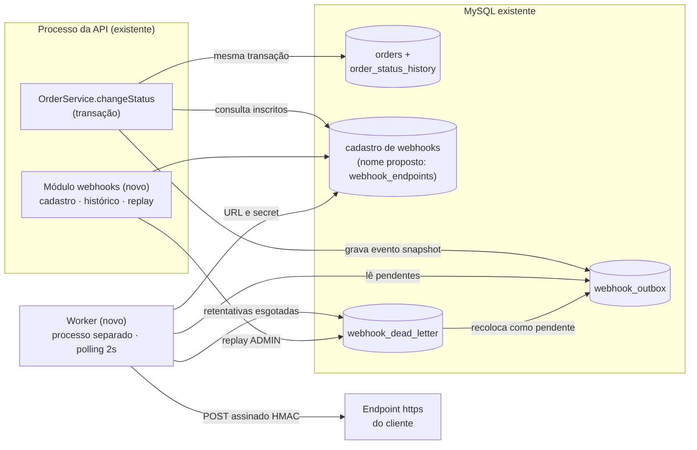

# RFC: Sistema de Webhooks de Notificação de Pedidos

## Metadados

| Campo | Valor |
|---|---|
| **Autoria** | @jeancsbnu, com apoio de IA (processo no [README](../README.md)) |
| **Responsabilidade técnica** | Larissa (Tech Lead), que se comprometeu a "abrir o doc de design da feature" e marcar a revisão ([09:50] Larissa). Tomamos este RFC como esse documento (interpretação). |
| **Status** | Em revisão |
| **Data** | 19/10/2026 (data de redação; a reunião de origem foi numa quinta-feira, sem data registrada) |
| **Revisores** | Bruno (Pedidos) e Diego (Plataforma): sessão de revisão antes de codar ([09:50] Larissa). Sofia (Segurança): revisão de "HMAC e geração de secret" ([09:46] Sofia). Marcos (PM): escopo e prazo (papel sugerido). |
| **Origem** | Reunião técnica registrada em [`TRANSCRICAO.md`](../TRANSCRICAO.md) |
| **Documentos ligados** | [PRD](PRD.md) (por quê e o quê), [ADRs](adrs/README.md) (decisões), [FDD](FDD.md) (como construir) |

Os trechos marcados *(interpretação, ADR-xxx)* cobrem pontos que a reunião não fechou. O ADR indicado explica a leitura adotada.

## Resumo (TL;DR)

- **O que propomos:** webhooks **outbound** que avisam clientes B2B quando o status de um pedido muda. A meta é ficar abaixo de 10s entre o commit da mudança e o primeiro envio *(interpretação de "tempo real", ver RFC-RISK-02)*.
- **Como o evento nasce e é entregue:** o evento é gravado numa **outbox no MySQL**, na mesma transação da mudança de status. Um **worker em processo separado** lê essa outbox a cada 2s e entrega.
- **Quando a entrega falha:** há **5 tentativas com backoff exponencial**, cobrindo cerca de 15h *(lidas como 5 retentativas após o envio inicial, interpretação, ADR-003)*. Esgotadas as tentativas, o evento vai para uma **DLQ**, com replay manual feito por ADMIN.
- **Segurança e garantia de entrega:** cada envio é assinado com **HMAC-SHA256** usando uma secret própria de cada endpoint, rotacionável. A entrega é **at-least-once**, e o cliente deduplica pelo `X-Event-Id`.
- **Infraestrutura:** nada novo além de um processo worker e algumas tabelas.
- **Onde pedimos atenção:** as [questões em aberto](#questões-em-aberto).

## Contexto e problema

Três clientes B2B pediram formalmente notificação em tempo real das mudanças de status de seus pedidos. Hoje eles fazem polling em `GET /orders`, o que deixa a integração "lenta e cara". Para eles, tempo real é "qualquer coisa abaixo de 10 segundos" ([09:00] Marcos, [09:02] Marcos). `RFC-CTX-02` O problema de negócio e as métricas estão no [PRD](PRD.md).

Hoje o sistema não tem nenhum mecanismo de notificação externa, de eventos ou de filas. Os módulos registrados em `src/routes/index.ts` são `auth`, `users`, `customers`, `products` e `orders`. `RFC-CTX-01`

A mudança de status ocorre em `OrderService.changeStatus` (`src/modules/orders/order.service.ts`), uma transação que já atualiza o pedido, o histórico e o estoque ([09:04] Bruno). A solução precisa respeitar três restrições:

- não travar nem desfazer mudanças de status ([09:04] Bruno);
- não exigir infraestrutura nova, porque o time é pequeno ([09:07] Diego);
- funcionar só no sentido de saída, da plataforma para o cliente ([09:02] Marcos).

## Proposta técnica

| ID | Componente | Visão geral | Base |
|---|---|---|---|
| RFC-PROP-01 | Registro transacional | Dentro da transação de `changeStatus`, uma nova função `publishWebhookEvent(tx, …)` grava em `webhook_outbox` o evento `order.status_changed`. Ela grava um evento por webhook do customer inscrito no novo status *(interpretação, ADR-001)*, com o payload já montado (snapshot). Se essa gravação falhar, a mudança de status é desfeita. | [ADR-001](adrs/ADR-001-outbox-no-mysql.md), [ADR-007](adrs/ADR-007-payload-snapshot-na-insercao.md) |
| RFC-PROP-02 | Entrega assíncrona | Worker em processo próprio (`src/worker.ts`, novo), no mesmo banco, lendo a cada 2s os pendentes mais antigos. Por ser instância única, mantém a ordem dos eventos de cada pedido, mas só no primeiro envio *(interpretação, ADR-002)*. | [ADR-002](adrs/ADR-002-worker-separado-em-polling.md) |
| RFC-PROP-03 | Resiliência | Retentativas com backoff exponencial por cerca de 15h. Depois disso, o evento é movido para `webhook_dead_letter`. O replay é manual, exclusivo de ADMIN e auditado. | [ADR-003](adrs/ADR-003-retry-backoff-e-dlq.md) |
| RFC-PROP-04 | Autenticidade | Assinatura HMAC-SHA256 do corpo, enviada no header `X-Signature`. Cada endpoint tem secret própria, gerada pela plataforma e rotacionável com 24h de carência. | [ADR-004](adrs/ADR-004-hmac-sha256-secret-por-endpoint.md) |
| RFC-PROP-05 | Semântica de entrega | At-least-once. O cliente deduplica pelo `X-Event-Id`, que se mantém igual nas retentativas e no replay *(interpretação, ADR-005)*. | [ADR-005](adrs/ADR-005-at-least-once-com-x-event-id.md) |
| RFC-PROP-06 | Superfície de API | Operações autenticadas para cadastrar, editar, remover e listar webhooks de um customer, escolher os status de interesse, consultar o histórico de entregas e rotacionar a secret. Há ainda uma operação administrativa de replay. Os contratos estão no [FDD](FDD.md). | [09:21] Sofia, [09:31] Marcos, [09:33] Bruno, [09:34] Marcos, [09:36] Larissa |
| RFC-PROP-07 | Encaixe no código | Novo módulo `src/modules/webhooks/` no padrão dos demais: `AppError` com prefixo `WEBHOOK_`, Pino e `requireRole`. O worker usa um PrismaClient próprio. | [ADR-006](adrs/ADR-006-reuso-dos-padroes-do-projeto.md) |

## Alternativas consideradas

Todas foram discutidas e descartadas na reunião. O raciocínio completo está nos ADRs.

| ID | Alternativa | Levantada por | Trade-off que levou ao descarte | ADR |
|---|---|---|---|---|
| RFC-ALT-01 | Disparo **síncrono** dentro de `changeStatus` | [09:03] Larissa | Acopla a mudança de status ao cliente. Um cliente lento trava outros pedidos, e um cliente fora do ar forçaria desfazer o status ou perder o evento ([09:04] Bruno, [09:06] Diego). | [001](adrs/ADR-001-outbox-no-mysql.md) |
| RFC-ALT-02 | **Fila externa** (Redis Streams) | [09:07] Larissa | Exige "subir mais infra". Para um time pequeno, é "overengineering" ([09:07] Larissa, [09:07] Diego). | [001](adrs/ADR-001-outbox-no-mysql.md) |
| RFC-ALT-03 | **Trigger no banco**, para o worker ser "mais reativo" | [09:09] Bruno | O MySQL não notifica processo externo e seria preciso improvisar. O polling de 2s já atende os 10s ([09:09] Diego). | [002](adrs/ADR-002-worker-separado-em-polling.md) |
| RFC-ALT-04 | **Retry indefinido** ou só **3 tentativas** | Indefinido: citado por Diego como posição de terceiros ([09:15] Diego). 3 tentativas: [09:16] Bruno | O retry indefinido deixa o evento "pendurado pra sempre" ([09:15] Diego). Três tentativas acabam em cerca de meia hora e não cobrem uma manutenção de 2h ([09:16] Diego). | [003](adrs/ADR-003-retry-backoff-e-dlq.md) |
| RFC-ALT-05 | **Exactly-once** | [09:25] Diego | Exige "coordenação dos dois lados" e "fica muito mais complexo" ([09:25] Diego). | [005](adrs/ADR-005-at-least-once-com-x-event-id.md) |
| RFC-ALT-06 | **Secret global** | [09:21] Sofia | "Se vaza uma, vaza tudo" ([09:21] Sofia). | [004](adrs/ADR-004-hmac-sha256-secret-por-endpoint.md) |

## Questões em aberto

Pontos levantados na reunião que ficaram sem decisão. A transcrição não designa responsáveis, então a última coluna é só sugestão do autor.

| ID | Questão | Estado na reunião | O que falta decidir | Responsável sugerido |
|---|---|---|---|---|
| RFC-OQ-01 | **Rate limiting de envio**: 50 pedidos de um cliente mudando em um minuto geram 50 chamadas? ([09:38] Diego) | Larissa: "observar e decidir depois" ([09:39] Larissa). Diego: implementar "se virar problema" ([09:39] Diego). | Qual sinal caracteriza o problema e qual seria o limite. *(Sugestão do autor: o histórico de entregas já mostra o volume por webhook.)* | Larissa, Diego |
| RFC-OQ-02 | **Escalar o worker** além de uma instância | "Problema do futuro, não agora". Opções: particionar por `order_id` ou usar lock pessimista ([09:13] Diego). | Gatilho para escalar e qual opção usar. RFC-RISK-02 pode antecipar a decisão. | Diego |
| RFC-OQ-03 | **Permissões do CRUD** de webhooks | "Por enquanto sim. Mais pra frente a gente pode endurecer" ([09:37] Sofia). | Escopo por cliente. Hoje o `customerId` vem no body ou no path ([09:32] Larissa), e qualquer usuário autenticado consegue gerir webhooks de qualquer customer. | Sofia, Larissa |
| RFC-OQ-04 | **Itens para a revisão de segurança** (derivados pelo autor) | Sofia vai revisar "HMAC e geração de secret" antes do deploy, em pelo menos 2 dias úteis ([09:46] Sofia). | Levar para a revisão: (a) secret armazenada de forma recuperável ([ADR-004](adrs/ADR-004-hmac-sha256-secret-por-endpoint.md)); (b) dupla assinatura durante a carência (ADR-004); (c) `X-Timestamp` fora da assinatura (ADR-004); (d) snapshot do pedido em repouso, decidido depois da saída de Sofia ([ADR-007](adrs/ADR-007-payload-snapshot-na-insercao.md)). (e) restrição de destinos das URLs cadastradas (SSRF), apontada na revisão do FDD ([FDD-RISK-11](FDD.md#13-riscos-e-mitigação)). | Sofia |
| RFC-OQ-05 | **Próxima fase do aviso por e-mail** | Decidido que o e-mail fica fora desta fase. A próxima ficou condicional: "Talvez próxima fase, depois que a gente medir o impacto" ([09:37] Larissa). | Qual métrica de impacto justifica a próxima fase | Marcos, Larissa |
| RFC-OQ-06 | **Arquivamento** das linhas entregues da outbox | "Linhas entregues a gente arquiva depois de 30 dias ou assim, fora do escopo dessa feature" ([09:08] Diego). | Política de arquivamento. *(Extensão do autor: a DLQ também cresce e guarda dados de pedidos.)* | Diego |

## Impacto e riscos

| ID | Impacto |
|---|---|
| RFC-IMP-01 | **Código e banco.** Uma chamada nova dentro de `changeStatus` (`src/modules/orders/order.service.ts`), o registro do novo módulo e novas tabelas por migration em `prisma/schema.prisma`. Os contratos HTTP existentes não mudam, mas o `PATCH /orders/:id/status` passa a falhar se a gravação na outbox falhar ([09:40] Bruno). |
| RFC-IMP-02 | **Operação.** Um novo processo, iniciado pelo novo script `npm run worker` em `package.json`, para implantar e monitorar. |
| RFC-IMP-03 | **Clientes.** Precisam expor um endpoint https, validar a assinatura e deduplicar. Isso será documentado em destaque no portal de desenvolvedor ([09:26] Marcos, [09:40] Marcos). |
| RFC-IMP-04 | **Cronograma.** São 3 sprints, com a revisão de segurança incluída ([09:46] Larissa, [09:47] Larissa). A Atlas quer "pra fim de novembro" ([09:45] Marcos). |

| ID | Risco | Mitigação | Referência |
|---|---|---|---|
| RFC-RISK-01 | A transação de status fica mais pesada: consulta os inscritos e grava um evento por inscrito. | Payload enxuto, sem itens. Índices na outbox. | [09:04] Bruno, [09:08] Diego, [09:43] Diego |
| RFC-RISK-02 | Com worker único, um cliente lento (até 10s por tentativa) atrasa a fila de todos. Então os 10s valem até o primeiro envio, não até a entrega. | Concorrência entre webhooks distintos que preserve a ordem por pedido *(proposta do autor, detalhada no [FDD](FDD.md))*. | [09:02] Marcos, [09:42] Diego |
| RFC-RISK-03 | Se o worker único parar, os eventos acumulam. Uma segunda instância subida por engano quebra a ordenação. | A outbox não perde eventos. Proteção contra instância dupla e monitoramento *(proposta do autor, FDD)*. | [09:12] Diego, [09:13] Diego |
| RFC-RISK-04 | A ordem dos eventos é garantida só por pedido, só com um worker e só no primeiro envio: retentativas podem inverter a ordem por até 12h. | Documentar como limitação conhecida. O cliente usa `from_status`, `to_status` e `timestamp` para reconciliar. | [09:13] Larissa, [09:17] Diego |
| RFC-RISK-05 | A outbox cresce sem arquivamento. | Índices em status e data de criação. Política de arquivamento em RFC-OQ-06. | [09:07] Bruno, [09:08] Diego |
| RFC-RISK-06 | Vazamento de secret, que já aconteceu com um cliente. | Secret por endpoint, rotação e revisão de segurança. Ocultar a secret nos logs *(proposta do autor, FDD)*. | [09:21] Sofia, [09:22] Diego |

## Decisões relacionadas

- [ADR-001](adrs/ADR-001-outbox-no-mysql.md): outbox no MySQL, na mesma transação da mudança de status
- [ADR-002](adrs/ADR-002-worker-separado-em-polling.md): worker em processo separado, polling de 2s, instância única
- [ADR-003](adrs/ADR-003-retry-backoff-e-dlq.md): retry com backoff, DLQ e replay ADMIN
- [ADR-004](adrs/ADR-004-hmac-sha256-secret-por-endpoint.md): HMAC-SHA256 com secret por endpoint e rotação com carência
- [ADR-005](adrs/ADR-005-at-least-once-com-x-event-id.md): at-least-once com deduplicação por `X-Event-Id`
- [ADR-006](adrs/ADR-006-reuso-dos-padroes-do-projeto.md): reuso dos padrões do projeto
- [ADR-007](adrs/ADR-007-payload-snapshot-na-insercao.md): payload snapshot na inserção
