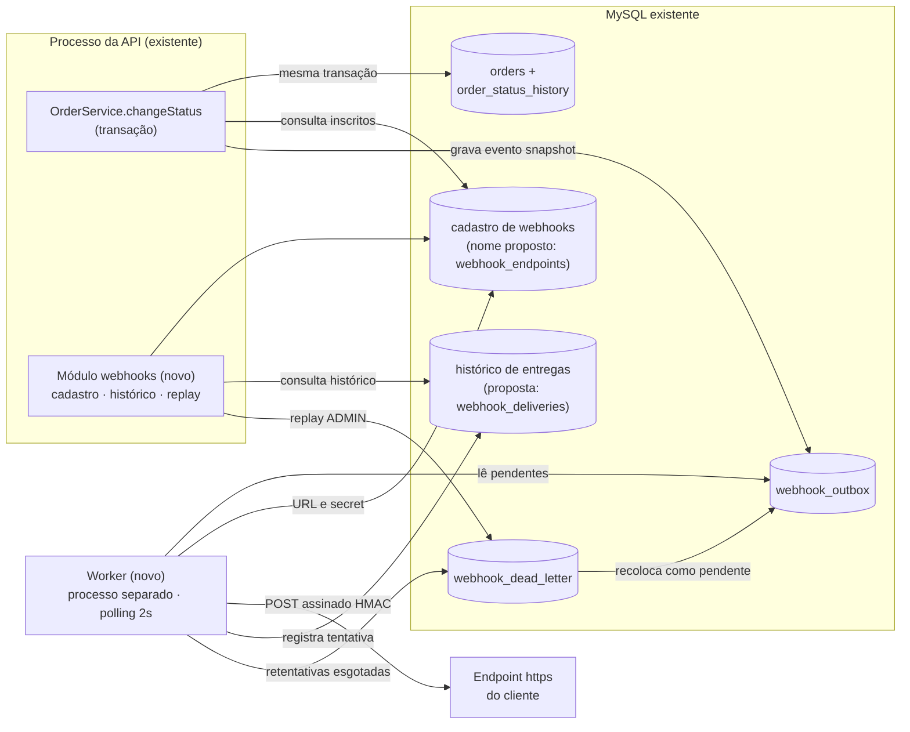

# RFC: Sistema de Webhooks de Notificação de Pedidos

## Metadados

| Campo | Valor |
|---|---|
| **Autoria** | @jeancsbnu, com apoio de IA (processo no [README](../README.md)) |
| **Responsabilidade técnica** | Larissa (Tech Lead), que ficou de "abrir o doc de design da feature" e marcar a revisão ([09:50] Larissa); este RFC é esse doc (interpretação). |
| **Status** | Em revisão |
| **Data** | 19/10/2026 (redação), revisado em 26/10/2026 só para enxugar o texto. A reunião foi numa quinta-feira, sem data registrada. |
| **Revisores** | Bruno (Pedidos) e Diego (Plataforma), antes de codar ([09:50] Larissa); Sofia (Segurança), "HMAC e geração de secret" ([09:46] Sofia); Marcos (PM), escopo e prazo (papel sugerido). |
| **Origem** | Reunião técnica ([`TRANSCRICAO.md`](../TRANSCRICAO.md)) |
| **Documentos ligados** | [PRD](PRD.md) (por quê e o quê), [ADRs](adrs/README.md) (decisões), [FDD](FDD.md) (como construir) |

Trechos *(interpretação, ADR-xxx)* cobrem pontos que a reunião não fechou; o ADR indicado explica a leitura.

## Resumo (TL;DR)

- **Proposta:** webhooks **outbound** avisam clientes B2B das mudanças de status de pedido, com meta abaixo de 10s do commit ao primeiro envio *(interpretação de "tempo real", ver RFC-RISK-02)*.
- **Como:** **outbox no MySQL** gravada na transação da mudança, **worker em processo separado** (polling de 2s), **5 tentativas com backoff exponencial** em cerca de 15h *(lidas como 5 retentativas após o envio inicial, interpretação, ADR-003)* e **DLQ** com replay manual por ADMIN.
- **Segurança e garantia:** **HMAC-SHA256** com secret rotacionável por endpoint; **at-least-once**, deduplicado pelo `X-Event-Id`.
- **Infraestrutura:** nada novo além do worker e algumas tabelas. Pedimos atenção às [questões em aberto](#questões-em-aberto).

## Contexto e problema

Três clientes B2B pediram formalmente notificação em tempo real das mudanças de status dos pedidos. Hoje fazem polling em `GET /orders`, integração "lenta e cara"; para eles, tempo real é "qualquer coisa abaixo de 10 segundos" ([09:00] Marcos, [09:02] Marcos). `RFC-CTX-02` Negócio e métricas: [PRD](PRD.md).

Não há notificação externa, eventos nem filas; `src/routes/index.ts` registra só `auth`, `users`, `customers`, `products` e `orders`. `RFC-CTX-01`

O status muda em `OrderService.changeStatus` (`src/modules/orders/order.service.ts`), transação que já atualiza pedido, histórico e estoque. A solução não pode travar nem desfazer mudanças de status ([09:04] Bruno), nem exigir infraestrutura nova, dado o time pequeno ([09:07] Diego), e deve ser só de saída, da plataforma para o cliente ([09:02] Marcos).

## Proposta técnica

| ID | Componente | Visão geral | Base |
|---|---|---|---|
| RFC-PROP-01 | Registro transacional | Na transação de `changeStatus`, a nova `publishWebhookEvent(tx, …)` grava em `webhook_outbox` um `order.status_changed` por webhook do customer **ativo, não removido e inscrito** no novo status *(interpretação, ADR-001)*, com payload snapshot. Se falhar, o status é desfeito. | [ADR-001](adrs/ADR-001-outbox-no-mysql.md), [ADR-007](adrs/ADR-007-payload-snapshot-na-insercao.md) |
| RFC-PROP-02 | Entrega assíncrona | Processo próprio (`src/worker.ts`, novo), no mesmo banco; a cada 2s lê os pendentes mais antigos, com seleção justa por endpoint ([FDD FLUXO-02](FDD.md#fdd-fluxo-02-ciclo-do-worker)). Instância única por lease, com ordem por pedido só no primeiro envio *(interpretação, ADR-002)*. | [ADR-002](adrs/ADR-002-worker-separado-em-polling.md) |
| RFC-PROP-03 | Resiliência | Backoff exponencial por cerca de 15h, depois `webhook_dead_letter`; replay manual, só ADMIN, auditado. | [ADR-003](adrs/ADR-003-retry-backoff-e-dlq.md) |
| RFC-PROP-04 | Autenticidade | HMAC-SHA256 do corpo em `X-Signature`; secret por endpoint, gerada pela plataforma, rotacionável com 24h de carência. | [ADR-004](adrs/ADR-004-hmac-sha256-secret-por-endpoint.md) |
| RFC-PROP-05 | Semântica de entrega | At-least-once; o cliente deduplica pelo `X-Event-Id`, estável em retentativas e replay *(interpretação, ADR-005)*. | [ADR-005](adrs/ADR-005-at-least-once-com-x-event-id.md) |
| RFC-PROP-06 | Superfície de API | CRUD autenticado dos webhooks de um customer (com desativar e reativar), status de interesse, histórico de entregas e rotação de secret; consulta e replay administrativos da DLQ *(listagem: proposta do FDD)*. Contratos no [FDD](FDD.md). | [09:21] Sofia, [09:31] Marcos, [09:33] Bruno, [09:34] Marcos, [09:36] Larissa |
| RFC-PROP-07 | Encaixe no código | Novo módulo `src/modules/webhooks/` no padrão do projeto (`AppError` com prefixo `WEBHOOK_`, Pino, `requireRole`); worker com PrismaClient próprio. | [ADR-006](adrs/ADR-006-reuso-dos-padroes-do-projeto.md) |

## Alternativas consideradas

Todas descartadas na reunião; detalhes nos ADRs.

| ID | Alternativa | Levantada por | Trade-off que levou ao descarte | ADR |
|---|---|---|---|---|
| RFC-ALT-01 | Disparo **síncrono** em `changeStatus` | [09:03] Larissa | Acopla o status ao cliente: lento, trava outros pedidos; fora do ar, força desfazer o status ou perder o evento ([09:04] Bruno, [09:06] Diego). | [001](adrs/ADR-001-outbox-no-mysql.md) |
| RFC-ALT-02 | **Fila externa** (Redis Streams) | [09:07] Larissa | Exige "subir mais infra", "overengineering" para time pequeno ([09:07] Larissa, [09:07] Diego). | [001](adrs/ADR-001-outbox-no-mysql.md) |
| RFC-ALT-03 | **Trigger no banco** ("mais reativo") | [09:09] Bruno | MySQL não notifica processo externo (seria improviso); polling de 2s já atende os 10s ([09:09] Diego). | [002](adrs/ADR-002-worker-separado-em-polling.md) |
| RFC-ALT-04 | **Retry indefinido** ou só **3 tentativas** | Indefinido: terceiros, citados por Diego. 3: [09:16] Bruno | Indefinido deixa o evento "pendurado pra sempre" ([09:15] Diego); 3 acabam em cerca de meia hora, sem cobrir manutenção de 2h ([09:16] Diego). | [003](adrs/ADR-003-retry-backoff-e-dlq.md) |
| RFC-ALT-05 | **Exactly-once** | [09:25] Diego | Exige "coordenação dos dois lados" e "fica muito mais complexo". | [005](adrs/ADR-005-at-least-once-com-x-event-id.md) |
| RFC-ALT-06 | **Secret global** | [09:21] Sofia | "Se vaza uma, vaza tudo". | [004](adrs/ADR-004-hmac-sha256-secret-por-endpoint.md) |

## Questões em aberto

Sem decisão na reunião. Responsáveis: sugestão do autor (a transcrição não os designa).

| ID | Questão | Estado na reunião | O que falta decidir | Responsável sugerido |
|---|---|---|---|---|
| RFC-OQ-01 | **Rate limiting de envio**: 50 pedidos de um cliente mudando num minuto geram 50 chamadas? ([09:38] Diego) | "Observar e decidir depois" ([09:39] Larissa); implementar "se virar problema" ([09:39] Diego). | Sinal do problema e limite. *(Sugestão do autor: o histórico de entregas mostra o volume por webhook.)* | Larissa, Diego |
| RFC-OQ-02 | **Escalar o worker** além de uma instância | "Problema do futuro, não agora"; particionar por `order_id` ou lock pessimista ([09:13] Diego). | Gatilho e opção; o FDD (FLUXO-02) só mitiga o cliente lento numa instância. | Diego |
| RFC-OQ-03 | **Permissões do CRUD** de webhooks | "Por enquanto sim. Mais pra frente a gente pode endurecer" ([09:37] Sofia). | Escopo por cliente: `customerId` vem no body ou path ([09:32] Larissa), e qualquer autenticado gere webhooks de qualquer customer. | Sofia, Larissa |
| RFC-OQ-04 | **Itens para a revisão de segurança** (derivados pelo autor) | Sofia revisará "HMAC e geração de secret" antes do deploy, em pelo menos 2 dias úteis ([09:46] Sofia). | (a) armazenamento recuperável da secret, (b) dupla assinatura na carência, (c) `X-Timestamp` fora da assinatura ([ADR-004](adrs/ADR-004-hmac-sha256-secret-por-endpoint.md)); (d) snapshot em repouso, decidido após a saída de Sofia ([ADR-007](adrs/ADR-007-payload-snapshot-na-insercao.md)); (e) restrição de destinos das URLs (SSRF), da revisão do FDD ([FDD-RISK-11](FDD.md#13-riscos-e-mitigação)); (f) rotação de emergência (`revokePrevious`) e bloqueio de nova rotação na carência, propostos no FDD ([FLUXO-07](FDD.md#fdd-fluxo-07-rotação-de-secret)). | Sofia |
| RFC-OQ-05 | **Próxima fase do aviso por e-mail** | E-mail fora desta fase (decidido); próxima condicional: "Talvez próxima fase, depois que a gente medir o impacto" ([09:37] Larissa). | Métrica de impacto que a justifica | Marcos, Larissa |
| RFC-OQ-06 | **Arquivamento** das linhas entregues da outbox | Arquivar "depois de 30 dias ou assim, fora do escopo dessa feature" ([09:08] Diego). | Política de arquivamento. *(Extensão do autor: a DLQ também cresce e guarda dados de pedidos.)* | Diego |

## Impacto e riscos

| ID | Impacto |
|---|---|
| RFC-IMP-01 | **Código e banco.** Nova chamada em `changeStatus` (`src/modules/orders/order.service.ts`), repasse opcional do id de correlação pelo controller *(proposta, FDD-INT-02)*, registro do módulo e tabelas novas por migration (`prisma/schema.prisma`). Contratos HTTP inalterados, mas `PATCH /orders/:id/status` falha se a outbox falhar ([09:40] Bruno). |
| RFC-IMP-02 | **Operação.** Novo processo a implantar e monitorar, via novo script `npm run worker` (`package.json`). |
| RFC-IMP-03 | **Clientes.** Expõem endpoint https, validam assinatura e deduplicam; documentação em destaque no portal de desenvolvedor ([09:26] Marcos, [09:40] Marcos). |
| RFC-IMP-04 | **Cronograma.** 3 sprints com a revisão de segurança ([09:46] Larissa, [09:47] Larissa); a Atlas quer "pra fim de novembro" ([09:45] Marcos). |

| ID | Risco | Mitigação | Referência |
|---|---|---|---|
| RFC-RISK-01 | Transação de status mais pesada (consulta inscritos, grava um evento por inscrito). | Payload enxuto, sem itens; índices na outbox. | [09:04] Bruno, [09:08] Diego, [09:43] Diego |
| RFC-RISK-02 | Worker único: um cliente lento (até 10s por tentativa) atrasa todos. Por isso, os 10s valem até o primeiro envio, não até a entrega *(interpretação, AMB-21)*. | Concorrência entre webhooks distintos, preservando a ordem por pedido *(proposta do autor, [FDD](FDD.md))*. | [09:02] Marcos, [09:42] Diego |
| RFC-RISK-03 | Worker parado acumula eventos; segunda instância por engano quebra a ordenação. | Outbox não perde eventos; proteção contra instância dupla e monitoramento *(proposta do autor, FDD)*. | [09:12] Diego, [09:13] Diego |
| RFC-RISK-04 | Ordem garantida só por pedido, com um worker e no primeiro envio; retentativas podem invertê-la por até 12h. | Limitação conhecida, documentada; cliente reconcilia por `from_status`, `to_status` e `timestamp`. | [09:13] Larissa, [09:17] Diego |
| RFC-RISK-05 | Outbox cresce sem arquivamento. | Índices em status e data de criação; arquivamento em RFC-OQ-06. | [09:07] Bruno, [09:08] Diego |
| RFC-RISK-06 | Vazamento de secret (já ocorreu com um cliente). | Secret por endpoint, rotação e revisão de segurança; secret oculta nos logs *(proposta do autor, FDD)*. | [09:21] Sofia, [09:22] Diego |
| RFC-RISK-07 | Cadastro inativo não gera eventos; pendentes pausam até 24h antes da DLQ *(proposta do FDD)*. | Documentar no portal; orientar a não desativar em manutenção curta, já coberta pelas retentativas. | [09:21] Bruno, [09:16] Diego |

## Decisões relacionadas

- [ADR-001](adrs/ADR-001-outbox-no-mysql.md): outbox no MySQL, na mesma transação
- [ADR-002](adrs/ADR-002-worker-separado-em-polling.md): worker separado em polling
- [ADR-003](adrs/ADR-003-retry-backoff-e-dlq.md): retry com backoff e DLQ
- [ADR-004](adrs/ADR-004-hmac-sha256-secret-por-endpoint.md): HMAC-SHA256 com secret por endpoint
- [ADR-005](adrs/ADR-005-at-least-once-com-x-event-id.md): at-least-once com `X-Event-Id`
- [ADR-006](adrs/ADR-006-reuso-dos-padroes-do-projeto.md): reuso dos padrões do projeto
- [ADR-007](adrs/ADR-007-payload-snapshot-na-insercao.md): payload snapshot na inserção
